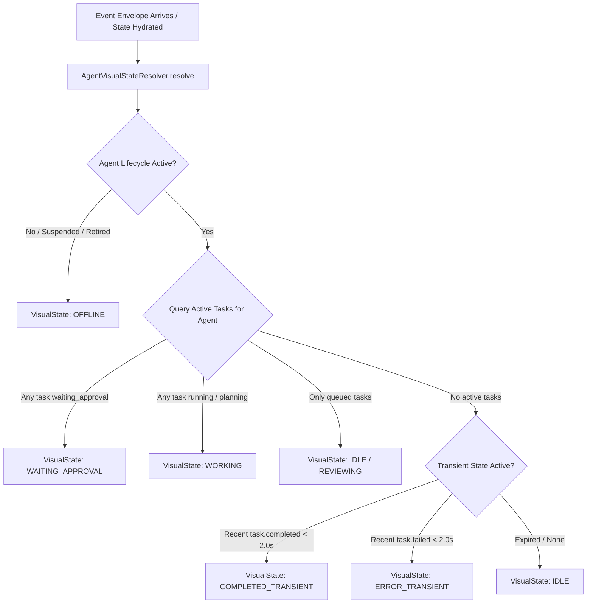

# PROVIPAGENT — Phase 3.1 3D World Architecture Blueprint (Corrected Baseline)

**Document Identifier:** `PHASE_3_1_ARCHITECTURE.md`  
**Revision:** `Phase 3.1.2 Final Architecture Verification`  
**Project:** PROVIPAGENT — Autonomous AI Company Operating System  
**Roles:** Principal Software Architect, Senior Backend Architect, Real-time Distributed Systems Engineer, Three.js / React Three Fiber Technical Architect, AI Agent Orchestration Architect, Application Security Architect, Performance Engineering Lead  
**Release Checkpoint Baseline:** `5a72886993d0b6721f52381117364894fcf2c39e`  
**Gate Status:** **SECURITY VERIFICATION PASS — ARCHITECTURE VERIFIED & READY FOR PHASE 3.2 BLUEPRINT APPROVAL**  
**Classification Standard:** Every architectural component is rigorously tagged as **[VERIFIED]**, **[PROPOSED]**, or **[UNKNOWN / BLOCKED]**.

---

## 1. Executive Summary & Authoritative System Philosophy

PROVIPAGENT is an **Autonomous AI Company Operating System**. It is **NOT** a standalone 3D video game, an office sandbox toy, or an ungrounded client-side animation reel.

The 3D environment is a **real-time spatial visualization and operational telemetry projection** of the actual backend workforce, task execution engine, and organizational state.

### Authoritative Architecture Axioms:
1. **Backend as the Single Source of Truth [VERIFIED]:**  
   The backend database (`agency.db`), task dispatcher, specialist catalog, and event engine authoritatively govern enterprise state. The 3D frontend is strictly a reactive presentation projection. A 3D avatar must never appear to work, move, or collaborate unless authoritative backend state confirms that operational reality.
2. **Deterministic State Reconciliation [PROPOSED / BLOCKED]:**  
   State synchronization must be resilient against socket disconnects, frame drops, network latency, sequence gaps, and browser sleep wakeups using sequence watermarks. Replay and snapshot mechanics currently require backend security and scoping corrections before implementation.
3. **Strict Entity Separation [VERIFIED]:**  
   Specialist catalog definitions are capabilities, not employees. Active workforce members are authoritative runtime records (`AgentModel` linked via `RecruitmentRecordModel`) assigned to physical workstations or virtual overflow.
4. **Decoupled Simulation & Presentation [PROPOSED]:**  
   The entity state machine and visual state resolver operate headlessly in memory without WebGL dependencies, ensuring testability in headless CI pipelines.
5. **Zero Trust Spatial Security [VERIFIED]:**  
   3D interactions (clicking an agent or desk) cannot mutate state directly or send client-asserted tenant identifiers. All state mutations invoke authenticated backend REST APIs subject to server-side RBAC and tenant membership resolution.

---

## 2. Evidence-Based Codebase Ground Truth Audit

### 2.1 Backend Runtime & Data Models [VERIFIED]

| Model / Service | Source Location | Verified Capabilities | Gaps / Limitations |
| :--- | :--- | :--- | :--- |
| **`AgentModel`** | [`backend/app/models/agent.py`](file:///Users/thienduc/Desktop/Code/provipagent/backend/app/models/agent.py#L10-L42) | Fields: `id`, `name`, `role`, `description`, `status` (`idle`, `working`, `waiting_approval`, `error`, `offline`), `current_task_id`, `station`, `pos_x`, `pos_y`, `pos_z`, `color`, `avatar`, `organization_id`. Index on `(organization_id, status)`. | `current_task_id` is a single nullable string; does not natively track concurrent subtasks per agent in the table column. |
| **`TaskModel`** | [`backend/app/models/task.py`](file:///Users/thienduc/Desktop/Code/provipagent/backend/app/models/task.py#L10-L61) | Fields: `id`, `parent_task_id`, `task_type` (`single`, `workflow`, `subtask`), `agent_type`, `title`, `description`, `status` (`queued`, `planning`, `running`, `waiting_approval`, `completed`, `failed`, `cancelled`), `priority`, `assigned_agent_id`, `organization_id`, `dependencies_json`. | Subtasks are hierarchical, but parent task completion requires multi-agent orchestrator loop completion. |
| **`WorkstationAllocationModel`** | [`backend/app/models/workstation.py`](file:///Users/thienduc/Desktop/Code/provipagent/backend/app/models/workstation.py#L21-L60) | Fields: `id`, `organization_id`, `agent_id` (unique), `department`, `logical_workstation_id`, `office_zone`, `desk_number`, `pos_x`, `pos_y`, `pos_z`, `allocation_status` (`ASSIGNED`, `VIRTUAL`, `UNASSIGNED`), `is_virtual`. Partial unique index `uq_assigned_physical_desk` enforces 1 agent per physical desk per department/org. | No direct REST endpoint exists to list workstation allocations separately from agents. |
| **`WorkstationService`** | [`backend/app/services/workstation_service.py`](file:///Users/thienduc/Desktop/Code/provipagent/backend/app/services/workstation_service.py#L14-L87) | `ZONE_CONFIGS` defines 8 zones with physical desk limits: Engineering (12), AI Research (10), Marketing (8), Sales (8), Operations (6), Finance (6), Customer Success (6), Executive (4). Total capacity = 60 desks. Automatically sets `is_virtual=True` when capacity exceeded. | The "48 desks" in prior docs was an ungrounded assumption; actual configured capacity across 8 departments is 60 desks. |
| **`SpecialistDefinitionModel`** | [`backend/app/models/specialist.py`](file:///Users/thienduc/Desktop/Code/provipagent/backend/app/models/specialist.py#L21-L77) | Catalog definitions (268 records) containing `slug`, `division`, `department`, `role`, `system_instructions`, `capabilities`, `skills`, `declared_tools`, `validation_status`, `lifecycle_state`. | Catalog definitions are NOT employees and have no organizational ownership. |
| **`SpecialistVersionModel`** | [`backend/app/models/specialist.py`](file:///Users/thienduc/Desktop/Code/provipagent/backend/app/models/specialist.py#L107-L125) | Immutable prompt snapshots (536 records) with `version`, `content_hash`, `raw_content`. | Pinned during recruitment to guarantee prompt execution provenance. |
| **`RecruitmentRecordModel`** | [`backend/app/models/recruitment.py`](file:///Users/thienduc/Desktop/Code/provipagent/backend/app/models/recruitment.py#L22-L84) | Formal organization employment linking `agent_id`, `specialist_definition_id`, `specialist_version_id`, `organization_id`, `department`, `manager_agent_id`, `lifecycle_state`. | Bridges catalog capability to authoritative tenant workforce. |
| **`AgentEventModel`** | [`backend/app/models/agent_event.py`](file:///Users/thienduc/Desktop/Code/provipagent/backend/app/models/agent_event.py#L10-L45) | Audit trail with `id`, `sequence_id`, `event_type`, `agent_id`, `task_id`, `organization_id` (RESTRICT foreign key), `payload_json`, `created_at`. `to_envelope()` outputs standard schema. | `sequence_id` is monotonic integer within the database; tenant events are strictly isolated. |
| **`WebSocketManager`** | [`backend/app/websocket_manager.py`](file:///Users/thienduc/Desktop/Code/provipagent/backend/app/websocket_manager.py#L20-L285) | JWT token authentication in query/header, server-side tenant resolution via `OrganizationMemberModel`, `broadcast_envelope` filtered by `organization_id`, handles `action="ping"`, `action="resync"`, `action="replay"` with strict tenant isolation and server-authorized superadmin scoping. | Fail-closed metadata handling verified; client spoofing of superadmin/tenant in replay frames rejected. |

### 2.2 Frontend Infrastructure & Rendering Stack [VERIFIED]

- **Framework & Runtime:** Next.js `16.4.3` (App Router) with React `19.3.0` and React-DOM `19.3.0`.
- **Installed 3D Libraries (`frontend/package.json`):**
  - `"three": "^0.186.1"`
  - `"@types/three": "^0.186.0"`
  - `"@react-three/fiber": "^9.8.2"`
  - `"@react-three/drei": "^10.7.9"`
  - `"@react-three/postprocessing": "^3.2.2"`
  - `"postprocessing": "^6.39.5"`
  - `"three-stdlib": "^2.36.1"`
- **State Management:** Zustand `^5.0.16` (`frontend/store/worldStore.ts`, 799 lines).
- **Existing 3D Components:**
  - Canvas: [`frontend/components/world/WorldCanvas.tsx`](file:///Users/thienduc/Desktop/Code/provipagent/frontend/components/world/WorldCanvas.tsx)
  - Lighting: [`frontend/components/world/WorldLighting.tsx`](file:///Users/thienduc/Desktop/Code/provipagent/frontend/components/world/WorldLighting.tsx)
  - Camera Controller: [`frontend/components/world/WorldCamera.tsx`](file:///Users/thienduc/Desktop/Code/provipagent/frontend/components/world/WorldCamera.tsx)
  - Architecture: [`frontend/components/world/OfficeArchitecture.tsx`](file:///Users/thienduc/Desktop/Code/provipagent/frontend/components/world/OfficeArchitecture.tsx)
  - Furniture: [`frontend/components/world/OfficeFurniture.tsx`](file:///Users/thienduc/Desktop/Code/provipagent/frontend/components/world/OfficeFurniture.tsx) (Contains 6 manual `<WorkstationDesk />` groups, NOT 48 instanced desks).
  - Characters: [`AgentCharacter.tsx`](file:///Users/thienduc/Desktop/Code/provipagent/frontend/components/world/characters/AgentCharacter.tsx), [`CorporateAgentAvatar.tsx`](file:///Users/thienduc/Desktop/Code/provipagent/frontend/components/world/characters/CorporateAgentAvatar.tsx), [`AgentStatusIndicator.tsx`](file:///Users/thienduc/Desktop/Code/provipagent/frontend/components/world/characters/AgentStatusIndicator.tsx).
- **Critical Architecture Flaw (`executeCorporateMission` / `executeMissionPipeline`) [VERIFIED]:**  
  In [`frontend/store/worldStore.ts`](file:///Users/thienduc/Desktop/Code/provipagent/frontend/store/worldStore.ts#L484-L797), `executeMissionPipeline` is invoked by `InteractiveMissionTerminal.tsx` (line 103). It runs an imperative loop with `setTimeout` (40ms lerp, 1500ms handoff, 1400ms completion), generating synthetic client-side deliverables (`.docx`, `.xlsx`, `.html`, `.json`) and updating agent statuses to `"working"` and `"idle"` locally. It **bypasses the FastAPI backend entirely**. It does not create tasks, does not call tools, and conflicts directly with real backend telemetry.

---

## 3. Critical Correction A — Backend Event Contract

### 3.1 Exhaustive Backend Event Inventory [VERIFIED]

The table below documents every event emitted across the active codebase:

| Event Type | Defined At | Emitted By | Payload Structure | Tenant Scoping | Frontend Consumer | Status |
| :--- | :--- | :--- | :--- | :--- | :--- | :--- |
| `task.created` | [`backend/app/services/event_service.py:12`](file:///Users/thienduc/Desktop/Code/provipagent/backend/app/services/event_service.py#L12) | `task_service.create_task` | `{"title", "priority", "assigned_agent_id", "organization_id"}` | Emitted with `organization_id` in payload. Filtered by `ws_manager`. | `frontend/app/page.tsx` (via WS listener) | **VERIFIED** |
| `task.started` | [`backend/app/services/event_service.py:14`](file:///Users/thienduc/Desktop/Code/provipagent/backend/app/services/event_service.py#L14) | `dispatcher.claim_task` | `{"status": "planning", "previous_status": "queued", "organization_id"}` | Emitted with `organization_id` in payload. Filtered by `ws_manager`. | `frontend/store/worldStore.ts` | **VERIFIED** |
| `agent.status_changed` | [`backend/app/services/event_service.py:21`](file:///Users/thienduc/Desktop/Code/provipagent/backend/app/services/event_service.py#L21) | `dispatcher.execute_claimed_task` | `{"status": "working", "sub_status": "THINKING"}` | Agent record has `organization_id`. Envelope broadcast. | `frontend/store/worldStore.ts` | **VERIFIED** |
| `task.plan_created` | Dynamic string | `dispatcher.execute_claimed_task` ([line 338](file:///Users/thienduc/Desktop/Code/provipagent/backend/app/agent_runtime/dispatcher/dispatcher.py#L338)) | `{"objective", "total_steps"}` | Scoped via task context. | Not currently consumed in 3D scene | **VERIFIED** |
| `task.step.started` | [`backend/app/services/event_service.py:27`](file:///Users/thienduc/Desktop/Code/provipagent/backend/app/services/event_service.py#L27) | `dispatcher.execute_claimed_task` ([line 346](file:///Users/thienduc/Desktop/Code/provipagent/backend/app/agent_runtime/dispatcher/dispatcher.py#L346)) | `{"step_index": 1, "title"}` | Scoped via task context. | Not currently consumed in 3D scene | **VERIFIED** |
| `task.step.completed` | [`backend/app/services/event_service.py:28`](file:///Users/thienduc/Desktop/Code/provipagent/backend/app/services/event_service.py#L28) | `dispatcher.execute_claimed_task` ([line 442](file:///Users/thienduc/Desktop/Code/provipagent/backend/app/agent_runtime/dispatcher/dispatcher.py#L442)) | `{"step_index", "title"}` | Scoped via task context. | Not currently consumed in 3D scene | **VERIFIED** |
| `tool.execution_started` | [`backend/app/services/event_service.py:31`](file:///Users/thienduc/Desktop/Code/provipagent/backend/app/services/event_service.py#L31) | `executor.execute_tool` ([line 212](file:///Users/thienduc/Desktop/Code/provipagent/backend/app/agent_runtime/executor.py#L212)) | `{"tool_name", "arguments"}` | Scoped via task context. | Not currently consumed in 3D scene | **VERIFIED** |
| `tool.execution_completed` | [`backend/app/services/event_service.py:32`](file:///Users/thienduc/Desktop/Code/provipagent/backend/app/services/event_service.py#L32) | `executor.execute_tool` ([line 257](file:///Users/thienduc/Desktop/Code/provipagent/backend/app/agent_runtime/executor.py#L257)) | `{"tool_name", "output", "duration_ms"}` | Scoped via task context. | Not currently consumed in 3D scene | **VERIFIED** |
| `tool.execution_failed` | [`backend/app/services/event_service.py:33`](file:///Users/thienduc/Desktop/Code/provipagent/backend/app/services/event_service.py#L33) | `executor.execute_tool` ([line 267](file:///Users/thienduc/Desktop/Code/provipagent/backend/app/agent_runtime/executor.py#L267)) | `{"tool_name", "error", "duration_ms"}` | Scoped via task context. | Not currently consumed in 3D scene | **VERIFIED** |
| `approval.required` | [`backend/app/services/event_service.py:35`](file:///Users/thienduc/Desktop/Code/provipagent/backend/app/services/event_service.py#L35) | `dispatcher.execute_claimed_task` ([line 405](file:///Users/thienduc/Desktop/Code/provipagent/backend/app/agent_runtime/dispatcher/dispatcher.py#L405)) | `{"approval_id", "action_type", "description"}` | Scoped via task context. | `frontend/app/page.tsx` (approval banner) | **VERIFIED** |
| `agent.waiting_for_approval` | [`backend/app/services/event_service.py:24`](file:///Users/thienduc/Desktop/Code/provipagent/backend/app/services/event_service.py#L24) | `dispatcher.execute_claimed_task` ([line 413](file:///Users/thienduc/Desktop/Code/provipagent/backend/app/agent_runtime/dispatcher/dispatcher.py#L413)) | `{"status": "waiting_approval"}` | Scoped via agent context. | `frontend/store/worldStore.ts` | **VERIFIED** |
| `task.completed` | [`backend/app/services/event_service.py:16`](file:///Users/thienduc/Desktop/Code/provipagent/backend/app/services/event_service.py#L16) | `dispatcher.execute_claimed_task` ([line 463](file:///Users/thienduc/Desktop/Code/provipagent/backend/app/agent_runtime/dispatcher/dispatcher.py#L463)) | `{"result_summary", "artifacts_count"}` | Scoped via task context. | `frontend/store/worldStore.ts` | **VERIFIED** |
| `agent.idle` | [`backend/app/services/event_service.py:22`](file:///Users/thienduc/Desktop/Code/provipagent/backend/app/services/event_service.py#L22) | `dispatcher.execute_claimed_task` ([line 471](file:///Users/thienduc/Desktop/Code/provipagent/backend/app/agent_runtime/dispatcher/dispatcher.py#L471)) | `{"status": "idle"}` | Scoped via agent context. | `frontend/store/worldStore.ts` | **VERIFIED** |
| `task.failed` | [`backend/app/services/event_service.py:17`](file:///Users/thienduc/Desktop/Code/provipagent/backend/app/services/event_service.py#L17) | `dispatcher.execute_claimed_task` ([line 512](file:///Users/thienduc/Desktop/Code/provipagent/backend/app/agent_runtime/dispatcher/dispatcher.py#L512)) | `{"error"}` | Scoped via task context. | `frontend/store/worldStore.ts` | **VERIFIED** |
| `task.cancelled` | [`backend/app/services/event_service.py:19`](file:///Users/thienduc/Desktop/Code/provipagent/backend/app/services/event_service.py#L19) | `task_service.cancel_task` ([line 194](file:///Users/thienduc/Desktop/Code/provipagent/backend/app/services/task_service.py#L194)) | `{"reason", "organization_id"}` | Emitted with `organization_id` in payload. Filtered by `ws_manager`. | `frontend/store/worldStore.ts` | **VERIFIED** |
| `workflow.created` | [`backend/app/services/event_service.py:40`](file:///Users/thienduc/Desktop/Code/provipagent/backend/app/services/event_service.py#L40) | `workflow_service.create_workflow` | `{"workflow_id", "title", "status", "priority", "organization_id"}` | Scoped via `organization_id`. Broadcast via `ws_manager`. | `frontend/app/page.tsx` | **VERIFIED** |
| `workflow.planned` | [`backend/app/services/event_service.py:41`](file:///Users/thienduc/Desktop/Code/provipagent/backend/app/services/event_service.py#L41) | `multi_agent_orchestrator` ([line 99](file:///Users/thienduc/Desktop/Code/provipagent/backend/app/agent_runtime/orchestrator/multi_agent_orchestrator.py#L99)) | `{"workflow_id", "goal", "subtasks_count", "subtasks"}` | Scoped via parent task org. Broadcast via `ws_manager`. | `frontend/store/worldStore.ts` | **VERIFIED** |
| `subtask.created` | [`backend/app/services/event_service.py:46`](file:///Users/thienduc/Desktop/Code/provipagent/backend/app/services/event_service.py#L46) | `multi_agent_orchestrator` ([line 142](file:///Users/thienduc/Desktop/Code/provipagent/backend/app/agent_runtime/orchestrator/multi_agent_orchestrator.py#L142)) | `{"subtask_id", "subtask_key", "assigned_agent_id", ...}` | Scoped via parent task org. Broadcast via `ws_manager`. | `frontend/store/worldStore.ts` | **VERIFIED** |
| `subtask.completed` | [`backend/app/services/event_service.py:49`](file:///Users/thienduc/Desktop/Code/provipagent/backend/app/services/event_service.py#L49) | `multi_agent_orchestrator` ([line 520](file:///Users/thienduc/Desktop/Code/provipagent/backend/app/agent_runtime/orchestrator/multi_agent_orchestrator.py#L520)) | `{"subtask_id", "subtask_key", "status", "summary"}` | Scoped via parent task org. Broadcast via `ws_manager`. | `frontend/store/worldStore.ts` | **VERIFIED** |
| `agent.result_received` | [`backend/app/services/event_service.py:53`](file:///Users/thienduc/Desktop/Code/provipagent/backend/app/services/event_service.py#L53) | `multi_agent_orchestrator` ([line 533](file:///Users/thienduc/Desktop/Code/provipagent/backend/app/agent_runtime/orchestrator/multi_agent_orchestrator.py#L533)) | `{"agent_id", "subtask_key"}` | Scoped via parent task org. Broadcast via `ws_manager`. | `frontend/store/worldStore.ts` | **VERIFIED** |
| `approval.decided` | Dynamic string | `approval_service.decide_approval` ([line 63](file:///Users/thienduc/Desktop/Code/provipagent/backend/app/services/approval_service.py#L63)) | `{"approval_id", "decision", "reason"}` | Persisted to DB. | **None (Gap: No WS broadcast!)** | **VERIFIED (Gap)** |
| `agent.created` | Dynamic string | `agent_service.create_agent` ([line 70](file:///Users/thienduc/Desktop/Code/provipagent/backend/app/services/agent_service.py#L70)) | `{"name", "role", "station"}` | Persisted to DB. | **None (Gap: No WS broadcast!)** | **VERIFIED (Gap)** |
| `agent.version_integrity_blocked` | Dynamic string | `dispatcher.claim_task` ([line 148](file:///Users/thienduc/Desktop/Code/provipagent/backend/app/agent_runtime/dispatcher/dispatcher.py#L148)) | `{"task_id", "agent_id", "organization_id", "reason"}` | Broadcast via `ws_manager`. | Not consumed in frontend | **VERIFIED** |

### 3.2 Event Envelope Structure & Delivery Semantics [VERIFIED]

The authoritative `EventEnvelope` generated by `AgentEventModel.to_envelope()` ([`backend/app/models/agent_event.py:30-45`](file:///Users/thienduc/Desktop/Code/provipagent/backend/app/models/agent_event.py#L30-L45)):

```python
{
    "schema_version": 1,
    "event_id": self.id,               # e.g. "evt_7d8e9f..."
    "event_type": self.event_type,       # e.g. "task.started"
    "occurred_at": iso_str,             # e.g. "2026-11-01T00:55:00.000000Z"
    "sequence_id": self.sequence_id,     # Monotonic integer
    "agent_id": self.agent_id,
    "task_id": self.task_id,
    "payload": self.payload_json or {},
}
```

#### Delivery Semantics Evaluation [VERIFIED]:
1. **Ordering:** `sequence_id` is monotonic within the SQLite database (`max(sequence_id) + 1`).
2. **Delivery Guarantee:** **At-most-once over WebSocket**. If the TCP connection drops, frames in transit are lost. Exactly-once is NOT guaranteed by transport.
3. **Event Identity:** `event_id` is a stable primary key string (`evt_<uuid16>`). Frontend can use this for duplicate detection.
4. **Validation:** `event_type` is checked loosely against `VALID_EVENT_TYPES` in docs, but `event_service.create_event` does NOT reject undeclared types. `payload_json` is an unvalidated JSON dictionary.
5. **Persistence:** Events persist to `agent_events` table indefinitely (no TTL / cleanup mechanism currently exists).

---

## 4. Critical Correction B — Snapshot, Replay & Resynchronization

### 4.1 Grounded Audit of Assumptions

| Prior Documentation Claim | Audit Status | Grounded Finding in Codebase |
| :--- | :--- | :--- |
| "Disconnect threshold of 60 seconds" | **REMOVED (Ungrounded)** | No 60-second threshold exists in backend code. This was an unverified heuristic. |
| "Sequence gap threshold of 100 events" | **REVISED / PROPOSED** | Backend `get_events_after` defaults to `limit=100`, but no automatic threshold is enforced in backend. |
| "last_sequence_id cursor replay" | **VERIFIED** | Implemented in `WebSocketManager.handle_incoming_message` ([line 261](file:///Users/thienduc/Desktop/Code/provipagent/backend/app/websocket_manager.py#L261)) for `action="replay"`. |
| "REST polling fallback every 3 seconds" | **REMOVED (Ungrounded)** | Frontend does not currently poll every 3 seconds; `useWorldStore` relied purely on socket or mock timers. |

### 4.2 Architectural Resolution: Tenant Replay Scoping & Sequence Delivery Semantics [VERIFIED]

- **Verified Implementation & Resolution:** In Phase 2.2.3 and 2.2.5, `get_events_after` in [`backend/app/services/event_service.py`](file:///Users/thienduc/Desktop/Code/provipagent/backend/app/services/event_service.py) was updated to enforce `organization_id` filtering. In `websocket_manager.py`, client replay requests (`action="replay"`) extract the verified connection tenant (`conn_org`) and execute `get_events_after(db, last_sequence_id, organization_id=conn_org)`. Tenant isolation on replay is fully verified by 28 automated security tests.
- **The Non-Contiguous Sequence ID Contract:**
  1. `AgentEventModel.sequence_id` is a monotonically increasing integer generated by `func.coalesce(func.max(sequence_id), 0) + 1` at the SQLite database level.
  2. Because WebSocket broadcasts and replays are filtered by `organization_id == conn_org`, events received by an individual tenant are strictly increasing (`seq_k < seq_{k+1}`) but **non-contiguous** (e.g., jumping from `10` to `15` if events 11–14 belonged to another tenant).
  3. **Client Contract Rule:** The frontend client tracks a high-water mark `last_applied_sequence_id = max(last_applied_sequence_id, event.sequence_id)`. The frontend client **must NOT** treat non-contiguous sequence gaps during live WebSocket streaming as packet loss. Live broadcast frames are delivered in-order over TCP.
  4. **Reconnection & Replay Protocol:** When the client reconnects after an interrupted connection, it issues `{"action": "replay", "last_sequence_id": last_applied_sequence_id}`. The server responds with all events for that tenant with `sequence_id > last_applied_sequence_id`. If the gap exceeds the server limit or if the connection drop is prolonged, the client issues `{"action": "resync"}` for a full snapshot.

### 4.3 Snapshot / Replay Watermark Race Condition Architecture [PROPOSED]

To prevent state corruption during reconnection:

```mermaid
sequenceDiagram
    autonumber
    participant Client as Frontend WS Client
    participant Server as FastAPI WebSocket
    participant DB as SQLite Session

    Note over Client: Reconnection established
    Client->>Server: {"action": "resync"}
    Server->>DB: Begin Read Transaction
    Server->>DB: Query max(sequence_id) -> watermark_seq
    Server->>DB: Query all active agents & tasks
    Server->>DB: Commit / End Read Transaction
    Server->>Client: Send Snapshot Frame (watermark_sequence_id = watermark_seq)
    Note over Client: Ingest snapshot; set last_applied_sequence_id = watermark_seq
    Note over Server: Live events arrive: seq=watermark_seq + 1, seq=watermark_seq + 2
    Server->>Client: Live Event Envelope (seq=watermark_seq + 1)
    Client->>Client: Apply live event (seq > last_applied_sequence_id)
```

1. **`snapshot_as_of_sequence_id` Watermark:** The snapshot must return the exact `sequence_id` corresponding to the queried database state.
2. **Replay Filtering:** Live events with `sequence_id <= snapshot_as_of_sequence_id` that arrive during or immediately after snapshot transmission must be dropped.
3. **Atomic Consistency Contract:** `build_initial_snapshot` must execute within a single transaction reading the max sequence ID alongside the agent and task records to prevent dirty reads.

---

## 5. Critical Correction C — Agent Entity Model (8-Tier Architecture)

The previous documentation conflated catalog entries with employees and 3D loaded assets. The corrected architecture defines **8 unambiguous tiers**:

```text
[Tier 1: SpecialistDefinition]  (Catalog capability; 268 records; not an employee)
            │
            ▼
[Tier 2: SpecialistVersion]     (Immutable prompt snapshot; 536 records; hash-pinned)
            │  (Formal recruitment via recruitment_service.recruit_specialist)
            ▼
[Tier 3: AgentModel]            (Authoritative database record in `agents` table)
            │  (Filter: RecruitmentRecordModel.lifecycle_state == 'ACTIVE')
            ▼
[Tier 4: ActiveAgent]           (Operational workforce member eligible for tasks)
            │  (Hydrated into Frontend Store via WebSocket snapshot/events)
            ▼
[Tier 5: VisualAgent]           (Lightweight presentation node in Scene Registry)
            │  (Filtered by Viewport Frustum & Distance Range)
            ▼
[Tier 6: LoadedAgent]           (3D Geometry / Material buffers loaded in memory)
            │  (Submitted in camera frustum draw call)
            ▼
[Tier 7: RenderedAgent]         (Mesh submitted to active WebGL render pass)
            │  (Active animation update loop in useFrame)
            ▼
[Tier 8: AnimatedAgent]         (Avatar actively receiving skeletal / IK updates)
```

### Detailed Tier Boundary Specifications:

| Tier | Boundary Layer | Authoritative Key | Description | Lifecycle Ownership |
| :--- | :--- | :--- | :--- | :--- |
| **1. SpecialistDefinition [VERIFIED]** | Backend DB (`specialist_definitions`) | `id` / `slug` | Abstract role definition imported from catalog markdown. Never rendered as a 3D character directly. | Catalog Importer / Admin |
| **2. SpecialistVersion [VERIFIED]** | Backend DB (`specialist_versions`) | `id` (UUID) | Content-hashed, immutable version of prompt and tools. | Catalog Synchronizer |
| **3. AgentModel [VERIFIED]** | Backend DB (`agents`) | `id` (e.g. `agent-exec-ceo`) | Physical database record possessing coordinates, organization ID, and status. | Backend Recruitment Service |
| **4. ActiveAgent [VERIFIED]** | Backend DB + Runtime Memory | `agent.id` | An `AgentModel` whose `RecruitmentRecordModel.lifecycle_state == 'ACTIVE'` (or executive agent). Eligible to be claimed by Dispatcher. | Recruitment Service / Dispatcher |
| **5. VisualAgent [PROPOSED]** | Frontend Zustand Scene Store | `agent.id` | Lightweight presentation representation containing interpolated `[x,y,z]`, target desk, and visual state. | Frontend Synchronizer |
| **6. LoadedAgent [PROPOSED]** | Browser / GPU Memory | `agent.id` | Agent whose 3D mesh assets, textures, and geometry are resident in Three.js memory. | Asset Loader / Three.js Cache |
| **7. RenderedAgent [PROPOSED]** | WebGL Render Pipeline | `agent.id` | A loaded agent currently inside the camera frustum and submitted in the draw call. | Three.js Frustum Culling |
| **8. AnimatedAgent [PROPOSED]** | R3F Frame Loop (`useFrame`) | `agent.id` | A rendered agent within animation range (e.g. < 25m) receiving active matrix updates. | Animation State Machine |

### Non-Conflation Rules:
- A `SpecialistDefinition` is **NEVER** automatically an employee.
- A `SpecialistDefinition` must **NEVER** generate a 3D character on the floor.
- A virtual/headless agent does **NOT** require a loaded 3D model.
- A loaded model is **NOT** necessarily rendered (it may be culled by the frustum).
- A rendered model is **NOT** necessarily animated (it may be static if distant).
- The frontend presentation layer must **NEVER** create employees or mutate `lifecycle_state`.

---

## 6. Critical Correction D — Workstation Allocation Ownership

### 6.1 Grounded Investigation Findings [VERIFIED]

1. **Backend Owns Allocation Exclusively:**
   - [`backend/app/services/workstation_service.py`](file:///Users/thienduc/Desktop/Code/provipagent/backend/app/services/workstation_service.py#L99-L253) (`allocate_workstation`) manages physical desk selection, desk coordinate calculation, and virtual overflow.
   - It is triggered authoritatively during recruitment in [`recruitment_service.py:179`](file:///Users/thienduc/Desktop/Code/provipagent/backend/app/services/recruitment_service.py#L179).
   - When an employee is retired, [`recruitment_service.py:418`](file:///Users/thienduc/Desktop/Code/provipagent/backend/app/services/recruitment_service.py#L418) calls `release_workstation`.
2. **Actual Capacity Limits (60 Physical Desks Across 8 Zones):**
   - In `workstation_service.py:14-87`, `ZONE_CONFIGS` allocates:
     - `Engineering`: 12 desks
     - `AI Research`: 10 desks
     - `Marketing`: 8 desks
     - `Sales`: 8 desks
     - `Operations`: 6 desks
     - `Finance`: 6 desks
     - `Customer Success`: 6 desks
     - `Executive`: 4 desks
     - **Total physical capacity: 60 desks** (Not 48).
3. **Desk Uniqueness Enforcement:**
   - Enforced by partial unique index `uq_assigned_physical_desk` on `("organization_id", "department", "desk_number")` WHERE `allocation_status = 'ASSIGNED' AND desk_number IS NOT NULL` ([`backend/app/models/workstation.py:51-59`](file:///Users/thienduc/Desktop/Code/provipagent/backend/app/models/workstation.py#L51-L59)).
4. **Virtual Workforce Overflow:**
   - When physical desks in a department are full, `allocate_workstation` gracefully assigns `allocation_status = "VIRTUAL"`, `is_virtual = True`, and `logical_workstation_id = f"vws-{dept_slug}-{desk_num}"` ([line 166-186](file:///Users/thienduc/Desktop/Code/provipagent/backend/app/services/workstation_service.py#L166-L186)).

### 6.2 Architectural Boundaries [MANDATORY RULE]

- **The backend owns workstation allocation.** The 3D renderer only displays the authoritative allocation recorded in backend state.
- **The frontend must never independently assign an agent to a desk.**
- **Physical-to-virtual transitions must not happen automatically in the frontend.**
- Floor dimensions (e.g. 44m × 34m) in `worldConfig.ts` are scene layout decisions, not backend business rules.

---

## 7. Critical Correction E — Task State to Visual State Resolver

### 7.1 Authoritative Backend State vs. Presentation State [VERIFIED]

The backend maintains two related but distinct state fields:
1. `TaskModel.status`: `"queued"`, `"planning"`, `"running"`, `"waiting_approval"`, `"completed"`, `"failed"`, `"cancelled"`.
2. `AgentModel.status`: `"idle"`, `"working"`, `"waiting_approval"`, `"error"`, `"offline"`.

### 7.2 Agent Visual State Resolver Design [PROPOSED]

To resolve state deterministically without race conditions:



### 7.3 Multi-Task & Transient State Rules:
1. **Concurrency Protection:** A single `task.completed` event must **NOT** set an agent to `IDLE` if another task assigned to that agent is still `running`.
2. **Transient Animation Reversion:** When a completion nod or celebratory particle burst is triggered, it runs for a strict duration (1.5s–2.0s). Upon timer expiration, the resolver queries authoritative store state to determine the subsequent pose.
3. **Animation Never Writes to State:** Animation loops and VFX callbacks may update local component refs, but must never dispatch mutations to the enterprise store.

---

## 8. Critical Correction F — Organization & Department Model

### 8.1 Grounded Findings on Organizational Structure [VERIFIED]

1. **`OrganizationModel` Exists [VERIFIED]:** [`backend/app/models/auth.py:20-41`](file:///Users/thienduc/Desktop/Code/provipagent/backend/app/models/auth.py#L20-L41) defines organizations with `id`, `name`, `slug`, `tier`, `is_active`.
2. **NO `DepartmentModel` Exists in Backend [VERIFIED]:**
   - Department is a string attribute on `SpecialistDefinitionModel.department`, `RecruitmentRecordModel.department`, and `WorkstationAllocationModel.department`.
   - There is no database table for departments, no department CRUD API, and no custom department configuration per tenant.
3. **Fictional Executive Identities in Codebase [VERIFIED]:**
   - "Victoria Vance" (`agent-exec-ceo`), "David Chen" (`agent-eng-lead`), "Dr. Elena Rostova" (`agent-research-ai`), "Sophia Martinez" (`agent-mkt-growth`), "Marcus Reynolds" (`agent-sales-director`), "Julian Thorne" (`agent-fin-controller`), "Amara Okafor" (`agent-ops-recruiter`), "Liam O'Connor" (`agent-support-lead`) were seeded in `backend/app/scripts/seed.py`.
   - In frontend mocks (`worldStore.ts`, `demoAgents.ts`), these identities were hardcoded into simulation strings.
4. **Architectural Separation:**
   - **Specialist Catalog Divisions:** Broad capability buckets (`engineering`, `marketing`, etc.).
   - **Organization Departments:** Tenant workforce grouping strings (`RecruitmentRecordModel.department`).
   - **Managerial Relationships:** Formal hierarchy pointers (`RecruitmentRecordModel.manager_agent_id`).
   - **Department Visual Zones:** Spatial scene boundaries in frontend scene configuration.

---

## 9. Critical Correction G — Tenant Isolation & Security Boundary

### 9.1 Verified Security Architecture [VERIFIED]

1. **Authentication & Session Validation:**
   - Validated via JWT token containing `sub` (user ID) and `ver` (token version).
   - Token version checked against `UserModel.token_version` on every WebSocket connection and REST call ([`backend/app/websocket_manager.py:72-75`](file:///Users/thienduc/Desktop/Code/provipagent/backend/app/websocket_manager.py#L72-L75)).
2. **Server-Side Tenant Resolution:**
   - Client is NEVER trusted to declare its tenant.
   - Backend resolves tenant membership from `OrganizationMemberModel` ([`websocket_manager.py:79-98`](file:///Users/thienduc/Desktop/Code/provipagent/backend/app/websocket_manager.py#L79-L98) and `core/auth.py:get_current_tenant_org`).
3. **Outbound Event Broadcast Isolation:**
   - `ws_manager.broadcast_envelope` filters every frame: if client tenant does not match event payload's `organization_id`, the message is suppressed ([`websocket_manager.py:163`](file:///Users/thienduc/Desktop/Code/provipagent/backend/app/websocket_manager.py#L163)).

### 9.2 Event Replay Tenant Isolation [VERIFIED]

- **Verified Resolution:** In Phase 2.2.3 and 2.2.5, `get_events_after` was remediated to enforce `organization_id == conn_org`. Migration `b8c9d0e1f2a3` added an indexed `organization_id` foreign key with `ondelete="RESTRICT"`. In `websocket_manager.py`, client-asserted `organization_id` or `is_superadmin` flags in incoming replay payloads are discarded; replay queries use the server-validated session metadata. Verified by 28 automated security tests.

---

## 10. Critical Correction H — Performance Claims & Benchmark Methodology

### 10.1 Audit of Previous Claims

- **Claim 1: "Current system generates > 1,200 draw calls."**  
  **Audit:** UNVERIFIED HYPOTHESIS. There is no automated benchmark or profile in the repository proving 1,200 draw calls. The current scene has 6 workstation desk groups and basic room geometry.
- **Claim 2: "Target is < 45 draw calls."**  
  **Audit:** PROPOSED TARGET. Achievable via `InstancedMesh` for repeated furniture, but requires empirical measurement.
- **Claim 3: "Guaranteed 60 FPS across 10 to 500 agents."**  
  **Audit:** UNVERIFIED SPECULATION. 60 FPS cannot be guaranteed across all devices without specifying reference hardware and rendering profiles.

### 10.2 Empirical Benchmarking Plan [PROPOSED]

#### Reference Hardware Profiles:
- **Tier 1 (Desktop / Workstation):** Apple Silicon M1 Max or Intel i7 + NVIDIA RTX 3060.
- **Tier 2 (Mid-range Laptop):** Apple Silicon M1 (base) or Intel i5 + integrated Iris Xe graphics.
- **Tier 3 (Constrained):** Mobile browser / Chromebook.

#### Measurement Metrics:
1. `renderer.info.render.calls` (Total WebGL draw calls).
2. `renderer.info.render.triangles` (Total rendered polygons).
3. Frame delta (ms) and 1% low FPS.
4. Heap memory consumption (MB).

#### Test Scenarios:
- **Scenario A (10 Active Agents):** Founding executive core; LOD 0; full shadow maps. Target: 60 FPS on Tier 1 & 2.
- **Scenario B (50 Active Agents):** 50 active employees; LOD 0 for nearby, LOD 1 for distant. Target: 60 FPS on Tier 1, ≥ 45 FPS on Tier 2.
- **Scenario C (100 Active Agents):** 60 physical desks populated + 40 moving/standing. Target: ≥ 45 FPS on Tier 1.
- **Scenario D (250–500 Agents):** 60 physical desks + 190–440 virtual fleet agents (headless telemetry). Since virtual fleet agents do not render physical meshes, draw calls and polygon count must remain identical to Scenario C!

---

## 11. Critical Correction I — Existing Frontend Architecture & `executeCorporateMission` Isolation Plan

### 11.1 Component Roles [VERIFIED]

| Component | Verified Current Role | Target Phase 3 Architecture |
| :--- | :--- | :--- |
| `frontend/store/worldStore.ts` | Monolithic store holding agents, deliverables, chat messages, and fake `executeMissionPipeline` timer loop. | Isolate 3D spatial state into `useSceneStore`. Remove/isolate `executeMissionPipeline`. |
| `WorldCanvas.tsx` | Standard R3F Canvas with ACESFilmic tone mapping, Bloom postprocessing, and fog. | Retain as visual foundation; inject dynamic context loss recovery. |
| `OfficeArchitecture.tsx` | Declarative JSX building walls, glass partitions, terrazzo flooring, exterior skyscraper backdrop. | Retain; convert to data-driven layout parser. |
| `OfficeFurniture.tsx` | Declarative JSX for 6 individual desk clusters, boardroom table, and soft seating. | Refactor repeated desks and chairs into `THREE.InstancedMesh`. |
| `AgentCharacter.tsx` | R3F character container mapping agent status to `CorporateAgentAvatar` and `AgentStatusIndicator`. | Keep container; decouple animation triggers from store polling. |
| `worldConfig.ts` | Floor configuration (`officeWidth: 44, officeDepth: 34`) and legacy camera bookmarks. | Standardize camera targets; remove legacy One Piece naming. |

### 11.2 `executeMissionPipeline` Removal / Isolation Plan [PROPOSED]

1. **Current State:** Reached via `InteractiveMissionTerminal.tsx` on form submit. Generates mock chat messages, hardcoded deliverables, and moves agents via `while` loops with `setTimeout(r, 40)`.
2. **Isolation Plan:**
   - **Step 1 (Phase 3.2):** Gate `executeMissionPipeline` behind `NEXT_PUBLIC_ENABLE_DEMO_SIMULATION=false`.
   - **Step 2 (Phase 3.2):** In `InteractiveMissionTerminal.tsx`, replace `executeMissionPipeline` with a real authenticated call to `POST /api/v1/tasks` or `POST /api/v1/workflows`.
   - **Step 3 (Phase 3.4):** Completely remove `executeMissionPipeline` from `worldStore.ts` once WebSocket event ingestion is verified.

---

## 12. Critical Correction J — Physical Interactions & Authorized Workflows

### 12.1 Interaction Rules [MANDATORY RULE]

1. **No Desk-Click Agent Spawning:** Clicking a desk cannot independently create an agent in frontend state. Any recruitment must submit an authenticated `POST /api/v1/recruitment/recruit` payload.
2. **Workstation Confirmation:** The 3D scene only places the newly recruited avatar at a desk after the backend confirms the allocation via WebSocket event or REST response.
3. **Boardroom Semantics:** A task creation event does **NOT** automatically mean an executive boardroom meeting. Agents must not wander to the conference table unless an authoritative multi-agent workflow explicitly models meeting participants.

---

## 13. System Architecture Readiness Matrix

| Architectural Domain | Classification | Blockers / Next Steps |
| :--- | :--- | :--- |
| **Backend Models & DB** | **VERIFIED** | Core tables (`agents`, `tasks`, `workstations`, `recruitment`, `specialists`) verified. |
| **Event Envelope & Inventory** | **VERIFIED** | Complete event inventory mapped to source lines. |
| **Tenant Isolation Ingestion** | **VERIFIED** | Zero trust for client headers. Verified in `auth.py`. |
| **Event Replay Scoping** | **VERIFIED** | Filtered by `organization_id == conn_org`. Verified by 28 automated security tests. |
| **Sequence ID Scoping** | **VERIFIED CONTRACT** | Monotonic integer in DB; non-contiguous tenant stream with client high-watermark tracking. |
| **Snapshot Watermark Protocol** | **PROPOSED** | Atomic watermark sequence ID contract required for resync. |
| **8-Tier Entity Model** | **VERIFIED / PROPOSED** | Distinct tiers formalized. |
| **60-Desk Capacity Enforcement** | **VERIFIED** | Verified in `workstation_service.py` (`ZONE_CONFIGS`). |
| **`executeCorporateMission` Isolation** | **PROPOSED** | Isolation plan detailed for Phase 3.2. |
| **Performance Benchmarks** | **PROPOSED** | Hypotheses converted to testable scenarios with defined metrics. |

---

*This corrected architecture document serves as the authoritative blueprint for Phase 3. Implementation remains locked until human review and approval.*
