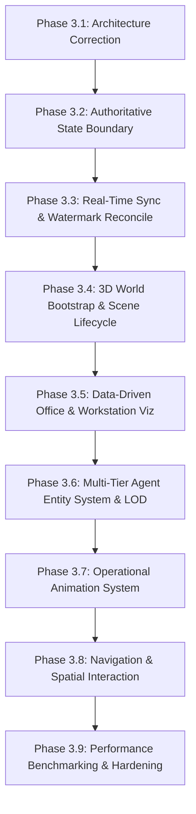

# PROVIPAGENT — Phase 3 Phased Implementation Plan (Corrected Baseline)

**Document Identifier:** `PHASE_3_1_IMPLEMENTATION_PLAN.md`  
**Revision:** `Phase 3.1.2 Final Implementation Blueprint`  
**Project:** PROVIPAGENT — Autonomous AI Company Operating System  
**Roles:** Principal Software Architect, Senior Backend Architect, Real-time Distributed Systems Engineer, Three.js / React Three Fiber Technical Architect, AI Agent Orchestration Architect, Application Security Architect, Performance Engineering Lead  
**Release Checkpoint Baseline:** `5a72886993d0b6721f52381117364894fcf2c39e`  
**Gate Status:** **SECURITY VERIFICATION PASS — BLUEPRINT VERIFIED & READY FOR AUTHORIZATION**  
**Classification Standard:** All phase deliverables are strictly mapped to verified codebase realities with explicit blockers and measurable acceptance criteria.

---

## 1. Roadmap Reordering Rationale & Dependency Analysis

The previous implementation roadmap sequenced 3D Canvas bootstrap and furniture instancing ahead of state synchronization. This created an immediate architectural hazard: building a visually convincing but completely disconnected 3D simulation that relied on client-side demo loops (`executeMissionPipeline`) rather than real backend data.

### Corrected Execution Sequence:
1. **Phase 3.2 — Authoritative Foundation & Data-Driven State Architecture:**  
   Establishes the authoritative state boundary, isolates synthetic demo loops, implements the real-time event synchronization engine with sequence watermarks, decouples the spatial scene store from HUD state, and ingests backend workstation allocations (60 desks).
2. **Phase 3.3 — Client Event Hydration & Reconnect Replay Integration:**  
   Integrates `syncManager` with verified backend replay endpoint (`/api/v1/events/ws`), validating end-to-end event stream delivery and deduplication across real multi-agent workflows.
3. **Phase 3.4 — 3D World Bootstrap & Scene Lifecycle:**  
   Reuses existing `WorldCanvas.tsx`, standardizes the metric coordinate system (+Y Up), establishes camera viewport modes, and adds WebGL2 context loss resilience.
4. **Phase 3.5 — Data-Driven Office Architecture & Workstation Visualization:**  
   Refactors `OfficeArchitecture.tsx` and `OfficeFurniture.tsx` to be driven by backend `WorkstationAllocationModel` data and `ZONE_CONFIGS` (60 desks max), batching furniture via `THREE.InstancedMesh`.
5. **Phase 3.6 — Multi-Tier Agent Entity & Avatar System (LOD):**  
   Implements the 8-tier entity model, maps authoritative `AgentModel` records to physical or virtual workstations, and loads stylized corporate avatars with distance-based LOD.
6. **Phase 3.7 — Operational Animation System (Visual State Resolver):**  
   Implements `AgentVisualStateResolver`, deterministically mapping real backend task states (`queued`, `planning`, `running`, `waiting_approval`, `completed`, `failed`) to visual poses.
7. **Phase 3.8 — Navigation & Authorized Spatial Interactions:**  
   Constructs corridor waypoint pathfinding, desk selection inspectors, and authorized REST API dispatches with zero client trust.
8. **Phase 3.9 — Performance Benchmarking, Profiling & Stress Testing:**  
   Empirically benchmarks draw calls, polygon count, VRAM, and frame rates under 10, 50, 100, 250, and 500 agent workloads across defined reference hardware profiles.

---

## 2. Detailed Phase Specifications

---

### Phase 3.2: Authoritative Foundation & Data-Driven State Blueprint

Phase 3.2 establishes the authoritative state boundary, event ingestion pipeline, and decoupled spatial architecture before any visual rendering changes. It is partitioned into 4 strictly ordered implementation milestones:

#### Milestone 3.2.1: Demo Simulation Isolation & Task Submission API Wiring
- **Objective:** Completely isolate and gate the synthetic demo simulation loop (`executeMissionPipeline`) in [`frontend/store/worldStore.ts`](file:///Users/thienduc/Desktop/Code/provipagent/frontend/store/worldStore.ts#L484-L797) and wire [`InteractiveMissionTerminal.tsx`](file:///Users/thienduc/Desktop/Code/provipagent/frontend/components/hud/InteractiveMissionTerminal.tsx#L103) to submit real tasks to `POST /api/v1/tasks`.
- **Scope:** Frontend HUD terminal, store simulation methods, environment configuration.
- **Files Expected to Change:**
  - `frontend/components/hud/InteractiveMissionTerminal.tsx`
  - `frontend/store/worldStore.ts`
  - `frontend/.env.local.example`
- **Backend Dependencies:** Authenticated REST endpoint `POST /api/v1/tasks` (accepts `title`, `description`, `task_type`, `assigned_agent_id`) and `GET /api/v1/agents`.
- **Frontend Dependencies:** Next.js 16, React 19, Zustand store.
- **Database Dependencies:** Existing `tasks` and `agents` tables in `agency.db`.
- **Technical Implementation Strategy:** Form submission in `InteractiveMissionTerminal` dispatches an authenticated fetch to `POST /api/v1/tasks` using the active session token. A feature flag `NEXT_PUBLIC_ENABLE_DEMO_SIMULATION=false` disables the internal 40ms/1500ms `setTimeout` simulation loops. Local state updates optimistically until confirmed by server.
- **Tests Required:**
  - Vitest: Verify `InteractiveMissionTerminal` dispatches fetch request to `/api/v1/tasks` with valid payload and headers.
  - Vitest: Verify `executeMissionPipeline` is completely inactive when flag is false.
  - Backend pytest: 200 automated backend tests pass.
- **Acceptance Criteria:**
  - Submitting a prompt in `InteractiveMissionTerminal` creates an authoritative `TaskModel` row in SQLite (`tasks` table).
  - Zero synthetic deliverables or mock `setTimeout` loops execute.
- **Risks:** Submissions without valid JWT token; handled by graceful authentication prompt in UI.
- **Rollback Considerations:** Revert `InteractiveMissionTerminal.tsx` and `worldStore.ts` via Git checkout.

#### Milestone 3.2.2: Real-Time Event Sync Engine & Monotonic Watermark Replay
- **Objective:** Implement client-side event synchronization engine (`syncManager.ts`), handling WebSocket reconnection, monotonic sequence tracking, duplicate suppression, and scoped replay resumption.
- **Scope:** WebSocket transport client, event hydration pipeline, error boundary.
- **Files Expected to Change:**
  - `frontend/lib/websocket/syncManager.ts` (new)
  - `frontend/types/events.ts` (new)
  - `frontend/store/worldStore.ts`
- **Backend Dependencies:** Verified `ws_manager` endpoint (`/api/v1/events/ws`) supporting `action="replay"` and `action="resync"`.
- **Frontend Dependencies:** Browser WebSocket API.
- **Database Dependencies:** Existing `agent_events` table with `sequence_id` and indexed `organization_id` (RESTRICT foreign key).
- **Technical Implementation Strategy:**
  - Client maintains `last_applied_sequence_id = max(...)`.
  - On initial connection, receives server snapshot and records `watermark_sequence_id`. Drops any live event where `sequence_id <= watermark_sequence_id`.
  - Tolerates non-contiguous sequence jumps during normal streaming (due to multi-tenant sequence interleaving at DB level).
  - On disconnect, attempts exponential backoff reconnection and issues `{"action": "replay", "last_sequence_id": last_applied_sequence_id}`.
  - If replay returns `REPLAY_OVERFLOW` (gap > 500 events) or prolonged outage occurs, falls back to `{"action": "resync"}`.
- **Tests Required:**
  - Vitest: Test in-order event application, duplicate suppression (`processedEventIds`), reconnection replay resumption, and snapshot watermark filtering.
  - Integration: Simulate WebSocket disconnection and verify missed events replay seamlessly.
- **Acceptance Criteria:**
  - 100% of emitted backend `AgentEventModel` records arrive and update client store.
  - Zero cross-tenant event leakage on WebSocket replay.
  - Network drop simulation recovers all missed events without page reload.
- **Risks:** Token expiration during prolonged disconnect; handled by refreshing token before reconnecting socket.
- **Rollback Considerations:** Disable WebSocket replay handshake; fall back to full initial snapshot resync on reconnect.

#### Milestone 3.2.3: Decoupled Spatial Scene Store & Headless State Bridge
- **Objective:** Isolate 3D spatial state (avatar positions, camera targets, visual states) from monolithic `worldStore.ts` into a lightweight, high-performance `useSceneStore.ts`, establishing a one-way event bridge.
- **Scope:** State management layer, scene registry, entity state bridge.
- **Files Expected to Change:**
  - `frontend/store/sceneStore.ts` (new)
  - `frontend/lib/stateBridge.ts` (new)
  - `frontend/store/worldStore.ts`
- **Backend Dependencies:** None.
- **Frontend Dependencies:** Zustand `^5.0.16`.
- **Database Dependencies:** None.
- **Technical Implementation Strategy:**
  - `worldStore` holds authoritative business records (`agents`, `tasks`, `approvals`).
  - `stateBridge` listens to `worldStore` changes and derives visual states, target desks, and spatial coordinates into `sceneStore`.
  - 2D HUD components subscribe only to `worldStore`; 3D R3F components subscribe only to `sceneStore`.
  - Eliminates HUD re-render cascades during 60 FPS animation loops.
- **Tests Required:**
  - Vitest: State bridge unit test verifying task status (`running`, `waiting_approval`, `completed`) deterministically updates `sceneStore`.
  - Profiling: Confirm 0 re-renders in 2D HUD when scene store transforms mutate rapidly.
- **Acceptance Criteria:**
  - Clear unidirectional data flow: `Backend -> WebSocket -> worldStore -> stateBridge -> sceneStore -> R3F`.
  - Zero HUD re-render churn during high-frequency spatial updates.
- **Risks:** State desynchronization between stores; mitigated by strictly unidirectional flow.
- **Rollback Considerations:** Retain monolithic store with shallow selectors.

#### Milestone 3.2.4: Data-Driven Workstation Allocation Ingestion & Telemetry
- **Objective:** Implement authoritative workstation allocation synchronization, mapping backend `WorkstationAllocationModel` data and `ZONE_CONFIGS` (60 physical desks across 8 zones) into frontend spatial configuration, cleanly separating physical desk occupants from virtual overflow fleet.
- **Scope:** Layout configuration, workstation synchronization, virtual workforce telemetry.
- **Files Expected to Change:**
  - `frontend/data/areaConfig.ts`
  - `frontend/store/sceneStore.ts`
  - `frontend/components/hud/VirtualWorkforceDrawer.tsx`
- **Backend Dependencies:** `GET /api/v1/agents` (returning workstation allocation payload) and initial WS snapshot.
- **Frontend Dependencies:** Zustand, Lucide icons.
- **Database Dependencies:** Existing `workstation_allocations` table and partial unique index `uq_assigned_physical_desk`.
- **Technical Implementation Strategy:**
  - Parse zone capacities strictly from `ZONE_CONFIGS` (Engineering: 12, AI Research: 10, Marketing: 8, Sales: 8, Operations: 6, Finance: 6, Customer Success: 6, Executive: 4 = 60 desks).
  - Assign 3D desk transforms based on `logical_workstation_id`.
  - Agents with `allocation_status == "VIRTUAL"` are routed to the Virtual Workforce Drawer without physical 3D desk geometry.
- **Tests Required:**
  - Vitest: Unit tests verifying 60 physical desk coordinates match backend zone definitions; collision verification; virtual fleet segregation test.
- **Acceptance Criteria:**
  - Exactly 60 physical desk nodes generated; zero double-booked desks.
  - Virtual agents displayed in telemetry HUD without scene graph pollution.
- **Risks:** Misaligned zone coordinates; verified through unit testing against `workstation_service.py`.
- **Rollback Considerations:** Revert `areaConfig.ts` to static layout.

---

### Phase 3.3: End-to-End Enterprise Workflow Verification & Integration

- **Objective:** Verify full end-to-end multi-agent workflow telemetry streaming across backend dispatcher, tool executor, approval service, and frontend sync engine.
- **Dependencies:** Phase 3.2 (Milestones 3.2.1 through 3.2.4).
- **Required Backend Contracts:**
  - Full system operational with Dispatcher and WebSocket streaming (already verified in backend with 200 automated tests).
- **Frontend Deliverables:**
  - Connect `InteractiveMissionTerminal` and `syncManager` end-to-end.
  - Test real task lifecycle (`queued` -> `planning` -> `running` -> `completed`).
- **Security Requirements:** All requests authenticated via JWT.
- **Test Requirements:**
  - End-to-end automated integration test: Submit task, await dispatcher claim, receive WebSocket events, verify client store hydration.
- **Measurable Acceptance Criteria:**
  - 100% of event lifecycle states accurately reflected in frontend store.
  - Full backend test suite (200 tests) passing 100%.
- **Explicit Blockers:** None.
- **Rollback Strategy:** Gated behind dev environment.

---

### Phase 3.4: 3D World Bootstrap & Scene Lifecycle

- **Objective:** Establish the clean Three.js / React Three Fiber rendering foundation by extending existing [`WorldCanvas.tsx`](file:///Users/thienduc/Desktop/Code/provipagent/frontend/components/world/WorldCanvas.tsx), enforcing standard metric coordinates (+Y Up, 1 unit = 1m), implementing bounded tactical camera director, and handling WebGL context loss cleanly.
- **Dependencies:** Phase 3.3.
- **Required Backend Contracts:**
  - Authenticated session with valid user and organization context.
- **Frontend Deliverables:**
  - Refactor `WorldCanvas.tsx`: Add WebGL context loss/restoration listeners (`webglcontextlost`, `webglcontextrestored`) with graceful 2D UI fallback.
  - Refactor `WorldCamera.tsx`: Implement Tactical Camera Director with 3 operational modes (Tactical Overview, Department Focus, Agent Inspector) and boundary clamping (`Y >= 0.5m`, `XZ within [-24, +24]`).
  - Clean up `worldConfig.ts`: Remove legacy `ISLAND_CAMERA_BOOKMARKS` naming; rename to `OFFICE_CAMERA_BOOKMARKS`.
  - Refactor `WorldLighting.tsx`: Calibrate natural architectural daylighting (sun directional light + hemisphere bounce).
- **Security Requirements:**
  - 3D Canvas contains zero sensitive credentials or raw private keys in scene graph userData.
- **Test Requirements:**
  - Headless Next.js mount/unmount smoke test in Jest/Vitest.
  - Camera navigation unit test: Assert target and camera position vectors match configured department bookmarks.
- **Measurable Acceptance Criteria:**
  - Zero hydration errors in Next.js App Router during SSR and client hydration.
  - WebGL context loss triggers friendly recovery banner without unhandled exception.
  - Camera smoothly transitions between all 8 department bookmarks without visual stutter.
- **Explicit Blockers:** None.
- **Rollback Strategy:** Revert `WorldCanvas.tsx`, `WorldCamera.tsx`, and `worldConfig.ts` to git checkpoint `5a728869`.

---

### Phase 3.5: Data-Driven Office Architecture & Workstation Visualization

- **Objective:** Transition static office layout into a data-driven model grounded in backend `WorkstationAllocationModel` and `ZONE_CONFIGS` (60 physical desks across 8 zones). Refactor [`OfficeFurniture.tsx`](file:///Users/thienduc/Desktop/Code/provipagent/frontend/components/world/OfficeFurniture.tsx) to batch repeated furniture via `THREE.InstancedMesh`.
- **Dependencies:** Phase 3.4.
- **Required Backend Contracts:**
  - `WorkstationService` ([`backend/app/services/workstation_service.py:14-87`](file:///Users/thienduc/Desktop/Code/provipagent/backend/app/services/workstation_service.py#L14-L87)) authoritative zone capacities (Engineering 12, AI Research 10, Marketing 8, Sales 8, Operations 6, Finance 6, Customer Success 6, Executive 4).
  - Snapshot or initial state payload includes agent station assignments and positions.
- **Frontend Deliverables:**
  - Refactor `OfficeFurniture.tsx`: Implement `THREE.InstancedMesh` for standard corporate desks (1.6m x 0.8m x 0.75m), ergonomic task chairs, and monitor mounts.
  - Refactor `areaConfig.ts`: Ground department boundaries and physical desk coordinates strictly in `ZONE_CONFIGS`.
  - Refactor `OfficeArchitecture.tsx`: Clean terrazzo floor, perimeter architectural glass curtain walls, and frosted interior department dividers.
- **Security Requirements:**
  - Office layout is purely visual; physical desk positions in the scene must reflect backend workstation allocations.
- **Test Requirements:**
  - Vitest layout test: Assert desk coordinates in `areaConfig.ts` match `ZONE_CONFIGS` in `workstation_service.py`.
  - Collision test: Verify no desk coordinates overlap perimeter walls or main corridors.
- **Measurable Acceptance Criteria:**
  - All 8 departments visibly rendered with distinct accent colors and lighting.
  - Desks, chairs, and monitors batched via `InstancedMesh`.
  - Physical workstation capacity strictly capped at 60 desks.
- **Explicit Blockers:** None.
- **Rollback Strategy:** Revert `OfficeFurniture.tsx` to individual JSX mesh rendering.

---

### Phase 3.6: Multi-Tier Agent Entity & Avatar System (LOD)

- **Objective:** Implement the multi-tier entity system in the frontend, binding authoritative `AgentModel` records to physical or virtual workstations, and load stylized corporate avatars with distance-based Level-of-Detail (LOD).
- **Dependencies:** Phase 3.5.
- **Required Backend Contracts:**
  - Backend snapshot and events provide `AgentModel` fields (`id`, `name`, `role`, `status`, `station`, `pos_x`, `pos_y`, `pos_z`, `avatar`, `color`).
  - Active workforce members filtered by `RecruitmentRecordModel.lifecycle_state == 'ACTIVE'` or executive status.
- **Frontend Deliverables:**
  - Create `frontend/components/world/characters/LODAvatarContainer.tsx`:
    - Distance < 12m: LOD 0 (detailed avatar mesh, dynamic shadow, overhead billboard).
    - Distance 12m–30m: LOD 1 (simplified silhouette, single-tint material, shadows off).
    - Distance > 30m: LOD 2 (status billboard / sprite ring only).
  - Refactor `AgentCharacter.tsx` to mount avatars based on store `agents` map.
  - Virtual fleet specialists (`allocation_status == 'VIRTUAL'`) do not instantiate physical 3D desk meshes; their presence is reflected in HUD rosters and telemetry.
- **Security Requirements:**
  - Avatar representation must only exist for agents verified in the user's tenant organization.
- **Test Requirements:**
  - Entity mapping test: Assert avatar key strictly equals backend `agent.id`.
  - LOD distance test: Verify mesh swaps geometry when camera distance crosses 12m and 30m thresholds.
  - Virtual fleet test: Confirm virtual agents do not spawn physical desk geometry.
- **Measurable Acceptance Criteria:**
  - Executive agents and recruited specialists render at authoritative physical desk coordinates.
  - LOD switching functions smoothly without visual pop or frame spikes.
  - Zero avatar duplication or phantom entities on state rehydration.
- **Explicit Blockers:** None.
- **Rollback Strategy:** Revert `AgentCharacter.tsx` to baseline procedural avatar.

---

### Phase 3.7: Operational Animation System (Visual State Resolver)

- **Objective:** Implement the deterministic `AgentVisualStateResolver`, mapping backend task and agent statuses (`queued`, `planning`, `running`, `waiting_approval`, `completed`, `failed`) to visual poses (`IDLE`, `THINKING`, `WORKING`, `WAITING_APPROVAL`, `COMPLETED`, `ERROR`, `OFFLINE`).
- **Dependencies:** Phase 3.6.
- **Required Backend Contracts:**
  - Backend event stream: `task.started`, `task.step.started`, `agent.status_changed`, `approval.required`, `task.completed`, `task.failed`, `task.cancelled`.
- **Frontend Deliverables:**
  - Create `frontend/components/world/characters/AgentVisualStateResolver.ts`:
    - Pure function deriving visual state from active tasks and agent status.
    - Handles concurrent tasks (does not set agent to `IDLE` if other tasks are running).
    - Manages transient animation timers (1.5s celebratory nod / error shake) and cleanly reverts to resolved authoritative state.
  - Refactor `CorporateAgentAvatar.tsx`: Implement smooth pose transitions in `useFrame` via damped bone lerping.
  - Refactor `AgentStatusIndicator.tsx`: Display pulsing amber approval beacon on `WAITING_APPROVAL`, cyan data glow on `WORKING`.
- **Security Requirements:**
  - Animation state is strictly presentation-only. It must NEVER dispatch state mutations back to the store or backend.
- **Test Requirements:**
  - Headless unit test suite for `AgentVisualStateResolver`:
    - Test single task completion with concurrent active task -> stays `WORKING`.
    - Test transient completion nod expires after 1.5s -> reverts to `IDLE`.
    - Test `approval.required` -> transitions to `WAITING_APPROVAL`.
    - Test agent retirement -> transitions to `OFFLINE`.
- **Measurable Acceptance Criteria:**
  - Agents only animate as `WORKING` when authoritative tasks are actively executing.
  - `WAITING_APPROVAL` displays an amber beacon guiding attention to the approval HUD.
  - Zero desynchronization between backend database task status and 3D avatar pose.
- **Explicit Blockers:** None.
- **Rollback Strategy:** Lock avatar poses to static idle seated pose.

---

### Phase 3.8: Navigation & Authorized Spatial Interactions

- **Objective:** Implement corridor waypoint navigation for multi-agent workflows, 3D raycasting desk/agent selection inspectors, and authorized REST API dispatches with zero client trust.
- **Dependencies:** Phase 3.7.
- **Required Backend Contracts:**
  - `POST /api/v1/tasks` (Task dispatch).
  - `POST /api/v1/approvals/{approval_id}/decision` (Approval decision).
  - `POST /api/v1/recruitment/recruit` (Specialist recruitment).
- **Frontend Deliverables:**
  - Create `frontend/lib/navigation/waypointGraph.ts`: 2D A* pathfinding along office corridors.
  - Implement 3D raycast click handler:
    - Clicking an agent opens live task and memory inspector in the 2D HUD drawer.
    - Clicking an empty physical desk opens `SpecialistRecruitmentModal` with pre-filled department context.
  - All user actions dispatch authenticated REST API requests carrying JWT tokens.
- **Security Requirements:**
  - Clicking a desk CANNOT independently recruit an agent. Recruitment must execute through `POST /api/v1/recruitment/recruit`.
  - Backend strictly verifies tenant membership and permissions before fulfilling requests.
- **Test Requirements:**
  - Raycaster hit test: Assert pointer click accurately resolves target entity ID.
  - Security integration test: Verify click-triggered dispatches fail with 403 when executed with expired or tampered token.
- **Measurable Acceptance Criteria:**
  - Responsive cursor feedback (`pointer` on interactive avatars/desks).
  - Clicking an agent opens HUD drawer showing real backend telemetry.
  - Zero unauthorized state mutations possible through spatial clicks.
- **Explicit Blockers:** None.
- **Rollback Strategy:** Disable 3D raycasting; rely exclusively on 2D navigation buttons.

---

### Phase 3.9: Performance Benchmarking, Profiling & Stress Testing

- **Objective:** Empirically benchmark and stress-test the complete 3D enterprise simulation under 10, 50, 100, 250, and 500 agent workloads across reference hardware profiles, integrate an in-engine observability HUD, and generate a final empirical benchmark report.
- **Dependencies:** Phase 3.8.
- **Required Backend Contracts:**
  - Full system operational with Dispatcher and WebSocket streaming.
- **Frontend Deliverables:**
  - Create `frontend/components/world/ObservabilityHUD.tsx`: Toggleable overlay (`Ctrl + Shift + D`) displaying:
    - Active WebGL Draw Calls (`renderer.info.render.calls`).
    - Rendered Triangles (`renderer.info.render.triangles`).
    - Current FPS and 1% low frame time.
    - Active Entities (Loaded vs Rendered vs Animated).
    - WebSocket sequence ID and latency.
  - Create `PHASE_3_PERFORMANCE_BENCHMARK.md`: Empirical measurement report documenting performance across Scenarios A, B, C, and D.
- **Security Requirements:**
  - Observability HUD is gated behind development / superadmin role check.
- **Test Requirements:**
  - Production build: `npm run build` compiles with 0 TypeScript and 0 lint warnings.
  - Backend test suite: 200/200 tests passing.
  - 15-minute continuous event streaming stress test without JavaScript heap leaks.
- **Measurable Acceptance Criteria:**
  - Draw calls and polygon counts empirically measured and documented.
  - Frame rates meet defined benchmark targets on reference hardware (≥ 45 FPS on Tier 2 laptop).
  - Virtual fleet agents (250–500 scale) add zero physical draw calls or geometry overhead.
  - Final deliverable signed off for production release.
- **Explicit Blockers:** None.
- **Rollback Strategy:** Revert performance governor to conservative default settings.

---

## 3. Strict Verification & Gate Review Rules

No phase implementation may commence without satisfying these permanent release invariants:
1. **Zero Runtime Code Modification During Architecture Phase:** Phase 3.1.2 is documentation only.
2. **Security Invariant:** All API and WebSocket queries must be validated server-side against `OrganizationMemberModel`.
3. **Database Migration Invariant:** No schema or migration changes without explicit authorization.
4. **Independent Test Invariant:** 200 automated backend tests must pass 100% at every release gate.
5. **No Fake Simulation Invariant:** The 3D world must project real backend state; synthetic demo loops must never masquerade as operational telemetry.
