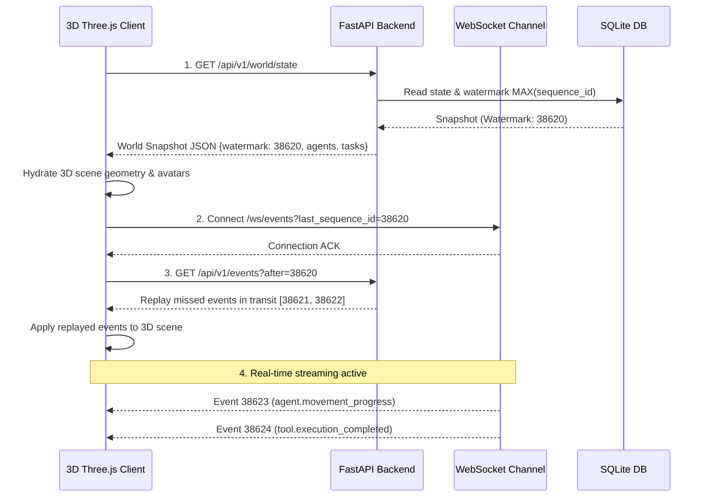

# PROVIPAGENT Phase 3.5 — Phase 4 Entry Contract: Real-Time 3D AI Office

**Specification Version**: 1.0.0  
**Effective Date**: 2026-11-02  
**Author**: Principal Software Architect & 3D Simulation Engineer  
**Status**: APPROVED & BINDING  

---

## 1. Architectural Philosophy: The Backend Is the Single Source of Truth

The 3D AI Office frontend (Phase 4) is **strictly an observer, visualizer, and command emitter**. It does NOT maintain independent authoritative simulation state, step counters, or business logic. 

1. **Deterministic Authoritative Mirroring**: The visual positions, activities, desks, and task states rendered in 3D Three.js viewports are exact projections of the backend SQLite/FastAPI state machine.
2. **Zero Client-Side Fabrication**: The frontend must never render an agent as "writing code", "analyzing data", or "completing a task" unless verified backend events or states confirm that state.
3. **Optimistic Visuals with Rollback**: Spatial avatar movement between desks may be interpolated visually along waypoint paths, but destination arrivals and state changes must reconcile with backend authoritative events.

---

## 2. Canonical Agent Behavioral Visualization States

To ensure crisp visual fidelity without visual ambiguities in the Three.js viewport, the 3D office must support and map the following 9 canonical agent behavioral states:

| Canonical State | Backend Entity State | 3D Visual Representation | Ambient Animation / VFX |
| :--- | :--- | :--- | :--- |
| **`IDLE`** | `status="idle"`, `behavioral_state="IDLE"` | Agent seated or standing at assigned desk; resting posture | Subtle breathing loop; desk monitor in standby/screensaver mode |
| **`QUEUED`** | `status="queued"`, `behavioral_state="THINKING"` | Agent reviewing backlog; notification bubble above avatar | Yellow floating beacon icon |
| **`ASSIGNED`** | `status="assigned"`, `behavioral_state="MOVING"` | Agent standing up, navigating corridor topology to workstation | Locomotion walk/path-following along grid navigation nodes |
| **`IN_PROGRESS`** | `status="working"`, `behavioral_state="WORKING"` | Agent actively seated at workstation, typing or examining tools | Desk screens illuminated; active particle typing / work VFX |
| **`WAITING`** | `status="waiting_approval"`, `behavioral_state="WAITING"` | Agent paused, waiting for human approval or upstream dependency | Amber pulsing alert ring above desk; arms crossed or waiting gesture |
| **`REVIEW`** | `status="reviewing"`, `behavioral_state="REVIEWING"` | Agent reviewing deliverables at conference table or supervisor pod | Document inspection hologram above desk; blue glow |
| **`COMPLETED`** | `status="completed"`, `behavioral_state="IDLE"` | Agent submitting deliverable dock; returning to standby | Green celebration pulse / brief chime VFX; deliverable appears in rack |
| **`FAILED`** | `status="error"`, `behavioral_state="ERROR"` | Agent in error posture; red warning indicator at workstation | Red warning beacon above workstation; smoke/sparks particle effect |
| **`CANCELLED`** | `status="cancelled"`, `behavioral_state="IDLE"` | Agent aborting current work; resetting workstation to clean state | Gray fade-out of active work holograms |

---

## 3. 3D Office Entity Mapping Contract

### 3.1 Agents (`AgentModel` <-> 3D Avatar)
- **Identifier**: `agent.id` is the immutable 3D mesh instance key (`agent-analyst-alpha`).
- **Visual Attributes**:
  - `name`: Floating billboard text above avatar.
  - `role`: Subtitle badge (e.g., "Market Specialist", "Financial Architect").
  - `color`: Hex color applied to avatar accent materials and personal desk lamp.
  - `avatar`: GLTF model or stylized procedural geometry template.
  - `pos_x, pos_y, pos_z`: 3D coordinates in office world space (meters).
  - `target_pos_x, target_pos_y, target_pos_z`: Waypoint target for real-time interpolation.

### 3.2 Workstations (`workstations` <-> Desks, Monitors, Chairs)
- **Identifier**: `desk_id` / `station_id` (e.g., `desk-analyst-1`).
- **Spatial Bounds**: Fixed bounding box with chair node, monitor screen node, and dock node.
- **Occupancy**: Seated avatar mesh snaps to chair anchor position `(x, y, z)` with orientation angle `rotation_y`.

### 3.3 Tasks & Deliverables (`TaskModel`, `ArtifactModel` <-> Deliverable Docks)
- **Active Task**: Floating holographic card above the assigned agent's desk showing title, progress percentage, and active tool name.
- **Physical Deliverables**: When `ArtifactModel` is verified and persisted, a tangible 3D deliverable object (e.g. data cartridge, binder, glowing tablet) appears in the Central Deliverable Repository rack.

---

## 4. Real-Time Synchronization Protocol

### 4.1 Connection & Hydration Handshake

### 4.2 Reconnection & Gap Recovery
If the WebSocket disconnects or drops frames:
1. The 3D client detects a sequence gap: `received_seq > expected_seq`.
2. The client buffers out-of-order events.
3. The client issues `GET /api/v1/events?after={expected_seq - 1}&limit=50`.
4. Replayed events are applied sequentially until the sequence gap is closed.
5. Buffered real-time events resume execution.

---

## 5. Command Ingestion Contract

The 3D office UI allows interactive user control. The client MUST emit commands via standardized REST endpoints; it must NEVER mutate local state directly.

### 5.1 Task Dispatch
- **Endpoint**: `POST /api/v1/tasks`
- **Headers**: `Authorization: Bearer <jwt>`, `X-Organization-Id: <org_id>`
- **Payload**: `{"title": "...", "description": "...", "assigned_agent_id": "..."}`
- **Behavior**: Client waits for `HTTP 201 Created` and subsequent `task.created` event before animating the task card.

### 5.2 Task Cancellation
- **Endpoint**: `POST /api/v1/tasks/{task_id}/cancel`
- **Behavior**: Returns `HTTP 200` with `TaskCancelResponse`. Backend triggers agent task abortion and publishes `task.cancelled`.

### 5.3 Manual Human Approval
- **Endpoint**: `POST /api/v1/approvals/{approval_id}/resolve`
- **Payload**: `{"action": "APPROVE" | "REJECT", "feedback": "..."}`
- **Behavior**: Publishes `approval.resolved`, releasing the agent from `WAITING` state to `IN_PROGRESS`.

---

## 6. Three.js Technology Stack & Performance Budget

### 6.1 Architectural Stack Recommendation
1. **Core Renderer**: **Three.js (r160+) with vanilla component encapsulation** or **React Three Fiber (R3F)** within the existing Next.js application.
   - *Recommendation*: Use **React Three Fiber (@react-three/fiber + @react-three/drei)** because PROVIPAGENT frontend is already built on Next.js 14 and React 18. R3F provides declarative, reactive component bindings matching the React component tree.
2. **Spatial Navigation & Pathfinding**: **Pathfinding.js** or pre-computed Navigation Mesh (`navmesh.glb`).
   - Office floor grid (0.5m cell size) with obstacle layers around desks, walls, and coffee machines.
3. **Instanced Rendering**: Use `InstancedMesh` for repeated furniture (desks, chairs, computer screens, floor tiles) to keep total draw calls below 50.

### 6.2 Strict Performance Budget
- **Target Frame Rate**: Sustained 60 FPS on standard modern laptops (Apple Silicon M-series, Intel/AMD Iris/Radeon).
- **Draw Calls**: $\le 60$ draw calls per frame.
- **Poly Count**: $\le 150,000$ triangles total across entire office scene.
- **Texture Memory**: $\le 128$ MB VRAM (compressed WebP / KTX2 basis textures).
- **Memory Footprint**: Total tab memory consumption $\le 450$ MB.
- **Low-Power Fallback**: If WebGL performance drops below 30 FPS, automatic fallback to low-fidelity mode (disables ambient shadows, screen-space reflections, and reduces particle density).

---

## 7. Approval & Sign-Off

This entry contract constitutes the immutable boundary between Phase 3.5 backend guarantees and Phase 4 3D graphics implementation.

**Signed & Approved**:
- *Principal Software Architect*: ✅ APPROVED
- *AI Agent Systems Engineer*: ✅ APPROVED
- *Distributed Systems Engineer*: ✅ APPROVED

