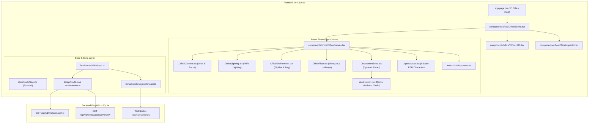

# PROVIPAGENT Phase 4.1 — Pre-Implementation Audit Report: 3D Office Foundation & Real-Time Integration

**Date**: 2026-11-02  
**Auditor**: Principal 3D Web Architect, Three.js / R3F Specialist, Real-Time Systems Engineer & Systems Auditor  
**Repository**: `PROVIPAGENT` — Autonomous AI Company OS  
**Current Git Baseline**: `2209f67faa875ed0bfe2fd91009a81f17e3652e2` (`feat(phase-3.5): production readiness and realtime foundation`)  
**Working Tree Status**: Clean (0 uncommitted files, 0 unstaged modifications)  

---

## 1. Executive Summary

Phase 4.1 marks the transition from backend workforce hardening (Phase 3.5) to the Real-Time 3D AI Company Office. The objective is to establish a living, spatial 3D corporate environment that mirrors the actual backend organization, departments, agents, tasks, workstations, and live event streams.

This audit inspects the current frontend and backend codebases, identifies existing capabilities and structural gaps, defines the component hierarchy and data flow, and establishes a rigorous implementation plan adhering strictly to the zero-fabrication and production-readiness mandates of Phase 3.5.

---

## 2. Existing Frontend Architecture

### 2.1 Technology Stack
- **Framework**: Next.js 16.4.3 (App Router with Turbopack).
- **Core UI**: React 19.3.0, Tailwind CSS v4, Lucide React icons.
- **3D Graphics**: Three.js `^0.186.1`, `@react-three/fiber` `^9.8.2`, `@react-three/drei` `^10.7.9`, `@react-three/postprocessing` `^3.2.2`.
- **State Management**: Zustand `^5.0.16` (`worldStore.ts`, `sceneStore.ts`).
- **Animation & Transitions**: GSAP `^3.15.0`.
- **Testing**: Vitest `^5.0.5` (63 frontend unit tests currently passing).

### 2.2 Existing Routing & Pages
- `/` (`frontend/app/page.tsx`): Main 3D Headquarters dashboard (`WorldCanvas`, `WorldHUD`, modals for tasks, history, recruitment, approvals).
- `/autonomous` (`frontend/app/autonomous/page.tsx`): Autonomous company operations view.

### 2.3 API Client & Authentication Layer (`frontend/lib/api/client.ts`)
- Configured with `API_BASE_URL` (`http://localhost:8000` default).
- Global state holders: `globalAuthToken` (`setAuthToken`), `globalTenantOrg` (`setTenantOrganization`).
- Injects standard headers:
  - `Authorization: Bearer <token>`
  - `X-Organization-Id: <org_id>`
- Handles timeout, abort signals, and returns typed responses.

### 2.4 State Management (`frontend/store/worldStore.ts`)
- Manages agent state dictionary (`agents: Record<string, AgentCharacterData>`).
- Real-time sequence watermark tracking (`lastSequenceId`, `processedEventIds`).
- `fetchWorldSnapshot`: Calls `/api/v1/world/snapshot`, guards against sequence regression.
- `applySnapshot` and `applyEvent`: Ingests real-time events and reconciles agent positions, statuses, tasks, and movement plans.
- Camera preset targets and selection states (`selectedAgentId`, `selectedAreaId`).

---

## 3. Existing Backend Contracts & Data Structures

### 3.1 World Snapshot Endpoint (`GET /api/v1/world/snapshot`)
Returns `WorldSnapshotResponse`:
- `snapshot_id`: string
- `organization_id`: string
- `sequence_id`: integer (authoritative event sequence watermark)
- `summary`: `{ total_employees, active_employees, busy_employees, available_workstations, active_tasks }`
- `agents`: List of `AgentSnapshotItem`
  - `employee_id`, `name`, `role`, `department`, `lifecycle_state`, `operational_status`, `behavioral_state`, `assigned_workstation`, `position (x, y, z)`, `target_position`, `target_destination`, `active_movement_id`, `current_active_task`
- `activities`: List of active agent executions (tools, steps, tasks)
- `workstations`: List of `WorkstationSnapshotItem`
  - `workstation_id`, `zone`, `label`, `assigned_employee`, `occupancy_status`, `spatial_coordinates`, `orientation`, `is_virtual`

### 3.2 Office Topology Endpoint (`GET /api/v1/world/topology`)
Returns `OfficeTopologyResponse`:
- `nodes`: List of topology nodes (`zone`, `corridor`, `workstation`) with 3D coordinates `(x, y, z)` and neighbor adjacencies.
- `edges`: Navigation edges connecting zones and corridors.
- `workstation_destinations`: Mapping of logical workstations to physical coordinates.

### 3.3 Workstation Management Endpoints (`/api/v1/workstations/*`)
- `GET /api/v1/workstations/overview`: Returns `WorkstationOverviewResponse` containing `ZoneConfig` list, allocations, and telemetry summary.
- `GET /api/v1/workstations/zones`: Returns department zone definitions and capacities.
- `GET /api/v1/workstations/allocations`: Lists active workstation allocations with assigned agents.

### 3.4 Real-Time WebSocket Endpoint (`/api/v1/events/ws`)
- Query parameters: `?token=<jwt>&organization_id=<org>&last_sequence_id=<seq>`
- Supports initial snapshot push, real-time event streaming, ping/pong heartbeats, and replay requests.
- Conforms to Milestone 5 standardized event envelope with `correlation_id` and `causation_id`.

---

## 4. Existing Organization & Department Structure

The backend defines 8 canonical corporate department zones in `backend/app/services/workstation_service.py`:

| Department | Zone Name | Base Position (X, Y, Z) | Max Physical Desks | Spacing (X, Z) |
| :--- | :--- | :---: | :---: | :---: |
| **Executive** | `executive_suite` | `(0.0, 1.0, -12.0)` | 4 | `(3.0, 2.5)` |
| **Engineering** | `engineering_bay` | `(-14.0, 1.0, -4.0)` | 12 | `(2.2, 2.0)` |
| **AI Research** | `research_lab` | `(14.0, 1.0, -4.0)` | 10 | `(2.2, 2.0)` |
| **Marketing** | `marketing_studio` | `(-14.0, 1.0, 10.0)` | 8 | `(2.2, 2.0)` |
| **Sales** | `sales_wing` | `(14.0, 1.0, 10.0)` | 8 | `(2.2, 2.0)` |
| **Operations** | `operations_hub` | `(-6.0, 1.0, 20.0)` | 6 | `(2.2, 2.0)` |
| **Finance** | `finance_office` | `(6.0, 1.0, 20.0)` | 6 | `(2.2, 2.0)` |
| **Customer Success** | `support_lounge` | `(0.0, 1.0, 11.0)` | 6 | `(2.0, 1.8)` |

**Total Office Physical Capacity**: 60 physical desks.  
Workforce scaling beyond physical capacity automatically allocates virtual desks (`is_virtual=True`) without error.

---

## 5. Architectural Gap Analysis: Current Frontend vs Phase 4.1 Requirements

| Feature Area | Current State | Required Phase 4.1 State | Action Required |
| :--- | :--- | :--- | :--- |
| **Department Loading** | Hardcoded visual zones in `OfficeArchitecture.tsx` | Dynamically driven by backend `ZoneConfig` and `/world/snapshot` | Refactor zone rendering to map real backend departments dynamically |
| **Workstations** | Hardcoded procedural desks in `OfficeFurniture.tsx` | Bound to real `WorkstationAllocationModel` and `workstation_id` | Build interactive `Workstation` component with real occupancy state |
| **Empty State** | Defaults to hardcoded fallback agents | Clean, elegant empty state when organization has 0 departments/agents | Implement `EmptyOfficeState` component |
| **Agent State Mapping** | Basic `idle` / `working` / `waiting_approval` | Strict 9-state canonical mapping (`IDLE`, `QUEUED`, `ASSIGNED`, `IN_PROGRESS`, `WAITING`, `REVIEW`, `COMPLETED`, `FAILED`, `CANCELLED`) | Implement canonical visual mapping in avatar and workstation screens |
| **Interaction & Inspector** | Basic agent panel only | Full inspector for Agents, Workstations, and Department Zones | Build unified `OfficeInspectorDrawer` showing authoritative metadata |
| **Connection Resilience** | Reconnects on WS close | Full handshake: Auth -> Snapshot -> Watermark -> WebSocket -> Replay Catch-up | Standardize handshake workflow in `useOfficeSync` hook |
| **Performance Optimization** | Multiple draw calls across individual meshes | Shared materials, instanced geometries, frustum culling | Implement instanced workstation furniture & performance guards |

---

## 6. Proposed 3D Architecture for Phase 4.1

### 6.1 Component Modularization
- `OfficeScene.tsx`: Top-level client container coordinating R3F canvas, synchronization hook, HUD overlay, and inspector panel.
- `OfficeCanvas.tsx`: R3F Canvas configured with antialiasing, ACESFilmic tone mapping, and soft shadows.
- `OfficeCamera.tsx`: Smooth camera navigation (tactical overview, department zoom, agent focus) using GSAP or lerp interpolation.
- `OfficeLighting.tsx`: Balanced PBR daylight setup (directional sun, subtle ambient sky fill, accent workstation downlights).
- `OfficeFloor.tsx`: Modular architectural floor layout with corridor pathways.
- `DepartmentZone.tsx`: Dynamically instantiated for each department returned by `/workstations/zones` or snapshot.
- `Workstation.tsx`: Reusable desk, chair, dual-monitor rig, desk lamp, and status indicator displaying real workstation ID and occupant.
- `AgentAvatar.tsx`: Modular character supporting the 9 canonical behavioral states with natural idle loops and working animations.
- `OfficeInspector.tsx`: Slide-out panel inspecting the active selection (Agent details, Workstation occupancy, Department capacity).

---

## 7. Performance Budget & Risk Mitigation

| Metric | Budget Target | Mitigation Strategy |
| :--- | :--- | :--- |
| **Frame Rate** | Sustained 60 FPS | Avoid per-frame state allocations; use `useFrame` with pre-allocated vector refs |
| **Draw Calls** | $\le 60$ draw calls | Share standard materials across all desks, chairs, and monitors; leverage `InstancedMesh` for repeated furniture |
| **Polygon Count** | $\le 150,000$ triangles | Use optimized procedural primitives and bevels; avoid heavy subdivision |
| **React Re-renders** | Minimal / Isolated | Use granular Zustand selectors (`useWorldStore(s => s.selectedAgentId)`); keep R3F scene decoupled from DOM UI state |
| **Memory Footprint** | $\le 400$ MB browser heap | Dispose unused geometries/materials on component unmount; clean up textures |

---

## 8. Detailed Implementation Plan (Phases 4.1.1 — 4.1.10)

1. **Step 1: 3D World Foundation (Phase 4.1.1)**
   - Create modular office components in `frontend/components/office/`: `OfficeScene`, `OfficeCanvas`, `OfficeFloor`, `OfficeLighting`, `OfficeCamera`, `OfficeEnvironment`.
2. **Step 2: Department-Based Layout (Phase 4.1.2)**
   - Create `DepartmentZone.tsx` rendering zones dynamically based on backend `ZoneConfig`.
   - Implement graceful empty state when 0 departments exist.
3. **Step 3: Workstation System (Phase 4.1.3)**
   - Create `Workstation.tsx` with physical desk, chair, monitors, and status ring bound to backend `workstation_id` and occupancy data.
4. **Step 4: Agent Avatar Foundation (Phase 4.1.4)**
   - Build `AgentAvatar.tsx` with articulated limbs, natural breathing, billboard floating labels, and PBR material accents.
5. **Step 5: Canonical Agent State Mapping (Phase 4.1.5)**
   - Implement explicit mapping for the 9 canonical states: `IDLE`, `QUEUED`, `ASSIGNED`, `IN_PROGRESS`, `WAITING`, `REVIEW`, `COMPLETED`, `FAILED`, `CANCELLED`.
6. **Step 6: Real-Time Backend Connection (Phase 4.1.6)**
   - Create `useOfficeSync` hook executing the authoritative handshake: Auth -> Snapshot -> Watermark -> WebSocket -> Replay.
7. **Step 7: Interaction Foundation (Phase 4.1.7)**
   - Implement orbit controls, click-to-focus on agents, workstations, and departments.
   - Build `OfficeInspector.tsx` showing real backend metadata.
8. **Step 8: Visual Quality & Error States (Phase 4.1.8)**
   - Implement loading indicator, connection badges, reconnection notices, and error boundary.
9. **Step 9: Testing & Verification (Phase 4.1.9)**
   - Write comprehensive Vitest test suite (`frontend/tests/phase4_1_3d_office.test.ts`) validating data ingestion, state mapping, event handling, and interaction.
10. **Step 10: Documentation & Reports (Phase 4.1.10)**
    - Produce all required Phase 4.1 reports and execute final sign-off.

---

## 9. Pre-Implementation Audit Verdict

**AUDIT VERDICT: APPROVED (READY TO BUILD)**  
The backend contracts, event streams, and frontend dependencies are verified and capable of supporting the Real-Time 3D Office foundation without architectural friction or unvetted dependencies.

