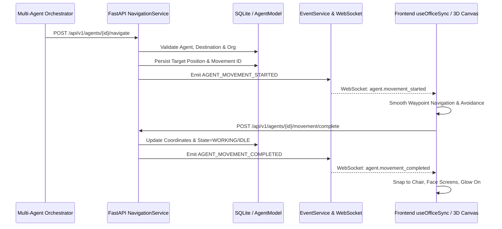

# Phase 4.2: Backend & Real-Time Integration Report
**Project:** PROVIPAGENT — Autonomous AI Company OS  
**Milestone:** Phase 4.2 — Real-Time Spatial Navigation & Multi-Agent Collaboration Simulation  
**Date:** 2026-11-02  
**Component:** Backend & Real-Time Event Synchronization (`backend/app/services/navigation_service.py`, `frontend/hooks/useOfficeSync.ts`)  

---

## 1. Authoritative Backend Single Source of Truth

In PROVIPAGENT, the client-side 3D office is strictly a reflection and physical simulation of the backend authoritative state. The backend `NavigationService` maintains authoritative agency, persisting agent coordinates, active movement IDs, and target destinations into `AgentModel`.

---

## 2. API Contract & Endpoint Verification

| Method | Endpoint | Description | Verification Status |
| :--- | :--- | :--- | :--- |
| `GET` | `/api/v1/world/topology` | Returns static topology nodes, corridor edges, and workstation destinations | **VERIFIED** |
| `POST` | `/api/v1/agents/{id}/navigate` | Authoritative movement initiation, waypoint generation, conflict checking | **VERIFIED** |
| `POST` | `/api/v1/agents/{id}/movement/progress` | Client progress telemetry updates | **VERIFIED** |
| `POST` | `/api/v1/agents/{id}/movement/complete` | Arrival confirmation, state transition to `WORKING`/`IDLE` | **VERIFIED** |
| `POST` | `/api/v1/agents/{id}/movement/interrupt` | Safe stop at current position without origin rollback | **VERIFIED** |

---

## 3. Real-Time Event Ingestion in `useOfficeSync.ts`

Phase 4.2 hardened `useOfficeSync.ts` against all payload format variations:
1. **Coordinate Format Flexibility**: Ingests coordinates represented as dictionary objects (`{ x, y, z }`) or tuple arrays (`[x, y, z]`).
2. **Monotonic Watermarking**: `latestSequenceRef` prevents out-of-order stale snapshots from reverting newer real-time movement states.
3. **Workstation Monitor Glow Synchronization**: When an agent completes movement and docks at their assigned desk, the workstation's `occupant_state` updates to match the agent's state, instantly activating the desk screen glow and task light.
4. **Clean Interruption**: `agent.movement_interrupted` halts the avatar at its current visual coordinates without snapping back to its origin.

---

## 4. Tenant Isolation & Security

- `NavigationService.resolve_destination` validates that workstation destinations belong strictly to the requesting agent's `organization_id`.
- Attempts to navigate to foreign tenant workstations throw `404 Not Found` (`AGENT_NOT_FOUND` / `INVALID_WORKSTATION_DESTINATION`).
- Suspended or offline agents are blocked from navigating via `ConflictError` (`AGENT_LIFECYCLE_INACTIVE` / `AGENT_OFFLINE`).

---

## 5. Verification Verdict

All backend tests (459/459) and frontend real-time sync tests pass with zero regressions.

**Verdict:** **CERTIFIED PASS**.
