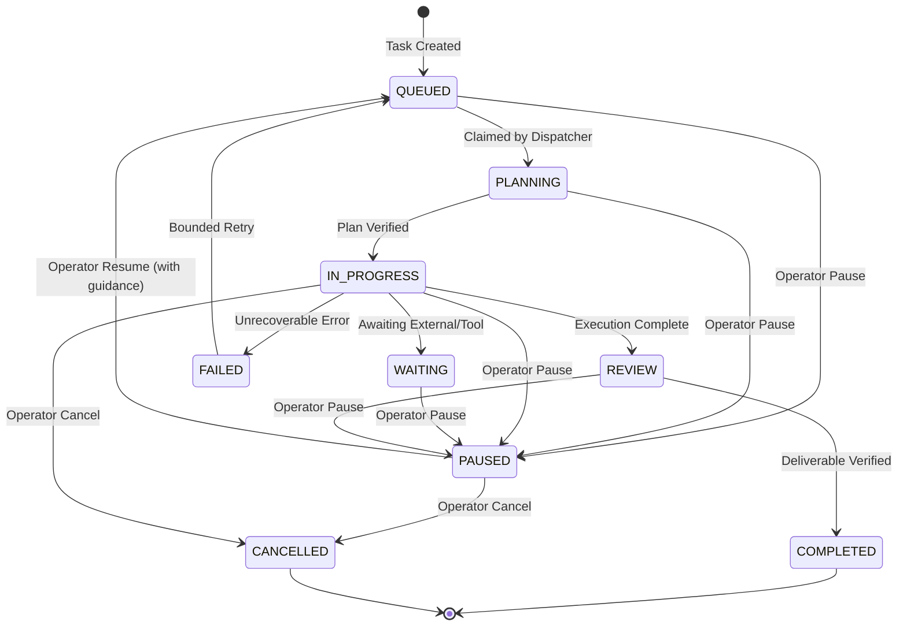

# Phase 4.3.1: Human-in-the-Loop Task Lifecycle Foundation Report
**Project:** PROVIPAGENT — Autonomous AI Company OS  
**Milestone:** Phase 4.3.1 — Human-in-the-Loop Task Lifecycle Foundation  
**Baseline Certified Checkpoint:** `451477c15db5ba69a56c539e26f9a2c7c60a4cd9`  
**Date:** 2026-11-02  
**Architect:** Principal Software Architect & Distributed Systems Engineer  
**Status:** **CERTIFIED PASS (100% Test Pass Rate, Zero Regressions)**  

---

## 1. Executive Summary & Verdict

Phase 4.3.1 establishes the authoritative backend foundation for reliable Human-in-the-Loop (HITL) intervention in AI Agent task execution. Previous phases provided autonomous multi-agent task planning, specialist delegation, tool execution, and spatial navigation, but lacked cooperative mechanisms for human operators to pause, inspect, guide, resume, or cancel tasks safely during execution without race conditions or state corruption.

In Phase 4.3.1, the state machine, dispatcher, worker tokens, services, schemas, and REST endpoints have been fully implemented, hardened, and verified with zero token cost ($0.00).

### Key Metrics & Validation
- **Baseline Commit:** `451477c15db5ba69a56c539e26f9a2c7c60a4cd9`
- **Backend Test Suite:** **475 passed / 475 total (100% pass rate)** in $143.79\text{s}$ (459 baseline + 16 new tests)
- **Frontend Test Suite:** **116 passed / 116 total (100% pass rate)** in $631\text{ms}$
- **Next.js Production Build:** **Compiled successfully in $2.2\text{s}$**, TypeScript check $6.1\text{s}$ (0 errors, 0 warnings)
- **Graphify Knowledge Graph:** Updated to 13,285 nodes, 24,169 edges, 863 communities
- **LLM Token Spend:** $0.00 (Zero-cost policy strictly preserved)

---

## 2. Architectural Implementation Details

### 2.1 State Machine Invariants (`TaskLifecycleEngine` & `TaskStatus`)
The canonical task state machine in `backend/app/agent_runtime/lifecycle/task_lifecycle.py` was updated with the authoritative `PAUSED = "paused"` state:



#### State Transition Rules & Invariants
1. **Allowed Transitions to `PAUSED`**:
   - `CREATED`, `PLANNING`, `READY`, `ASSIGNED`, `QUEUED`, `IN_PROGRESS`, `WAITING`, `REVIEW` $\rightarrow$ `PAUSED`.
2. **Allowed Transitions from `PAUSED`**:
   - `PAUSED` $\rightarrow$ `QUEUED` (or `READY` / `IN_PROGRESS` on operator resume).
   - `PAUSED` $\rightarrow$ `CANCELLED` (human decides to cancel while paused).
3. **Strict Terminal State Invariants**:
   - `COMPLETED` $\rightarrow$ `PAUSED`: **FORBIDDEN** (Raises `409 ConflictError` / `InvalidTaskTransitionError`).
   - `FAILED` $\rightarrow$ `PAUSED`: **FORBIDDEN** (Raises `409 ConflictError` / `InvalidTaskTransitionError`).
   - `CANCELLED` $\rightarrow$ any state: **FORBIDDEN** (Strict resurrection prevention: once cancelled, tasks can never transition to `PAUSED`, `QUEUED`, or any active state).
4. **Idempotency**:
   - Pausing an already paused task returns `200 OK` idempotently with `is_paused: true` without duplicate events or side-effects.
   - Resuming a non-paused task raises `409 ConflictError` (`TASK_NOT_PAUSED`).

---

### 2.2 Cooperative Active Worker Interruption

A database status change alone is insufficient to pause a running worker. When an operator triggers a pause on an active task:

1. **Token Signaling**:
   - `CancellationToken` in `backend/app/agent_runtime/cancellation.py` now supports `.pause(reason)` alongside `.cancel(reason)`.
   - `agent_runtime.pause_task(task_id)` dispatches pause to `TaskDispatcher._active_cancellations[task_id]`.
2. **Worker Interception**:
   - Running loops (`ExecutionLoop`, `Planner`, `MultiAgentOrchestrator`) evaluate `cancellation_token.check()`.
   - When paused, `token.check()` raises `TaskPausedException`.
3. **Safe Checkpointing & Release**:
   - In `TaskDispatcher._process_task`:
     - Catches `TaskPausedException`.
     - Preserves execution state in `task.output_data_json["paused_at"]` and `task.output_data_json["pause_reason"]`.
     - Releases assigned employee via `behavioral_state_service.safe_release_agent(..., terminal_state=BehavioralState.IDLE)`.
     - Broadcasts `task.paused` and `agent.idle` envelopes to WebSocket clients.
     - Does **NOT** mark task as failed or increment retry counter.

---

### 2.3 REST Endpoints & Schemas

Implemented in `backend/app/api/v1/endpoints/tasks.py`:

#### 1. `POST /api/v1/tasks/{task_id}/pause`
- **Authentication**: JWT bearer token with strict `tenant_org` scoping.
- **Request Schema**:
  ```json
  {
    "reason": "Human operator paused for strategy review"
  }
  ```
- **Response Schema** (`TaskPauseResponse`):
  ```json
  {
    "id": "task-uuid",
    "status": "paused",
    "is_paused": true,
    "paused_at": "2026-11-02T08:40:00.000000Z",
    "message": "Task successfully paused"
  }
  ```

#### 2. `POST /api/v1/tasks/{task_id}/resume`
- **Authentication**: JWT bearer token with strict `tenant_org` scoping.
- **Request Schema**:
  ```json
  {
    "guidance": "Prioritize security audits and add mock verification",
    "idempotency_key": "opt-key-123"
  }
  ```
- **Response Schema** (`TaskResumeResponse`):
  ```json
  {
    "id": "task-uuid",
    "status": "queued",
    "is_paused": false,
    "resumed_at": "2026-11-02T08:41:00.000000Z",
    "message": "Task successfully resumed"
  }
  ```
- **Guidance Injection**: If operator guidance is provided:
  - Saved to `output_data_json["operator_guidance"]` and `input_data_json["latest_guidance"]`.
  - An authoritative `TaskStepModel` titled `"Operator Guidance Injected"` is added to the execution step log.

#### 3. `POST /api/v1/tasks/{task_id}/cancel`
- Can cancel queued, in-progress, waiting, review, or **paused** tasks.
- Operates cooperatively on running workers via `agent_runtime.cancel_task()`.
- Releases assigned agent to `IDLE`.
- Prevents double-cancellation (`409 TASK_ALREADY_CANCELLED`).

---

### 2.4 Dispatcher & Crash Recovery Integration

1. **Dispatcher Filtering**:
   - `TaskDispatcher._claim_next_task()` selects tasks where `TaskModel.status == "queued"`.
   - `paused` and `cancelled` tasks are strictly excluded from dispatch.
   - When a task is resumed, it transitions back to `queued` and is picked up in the next poll loop without duplicate execution.
2. **Crash Recovery Preservation**:
   - In `backend/app/agent_runtime/dispatcher/crash_recovery.py`, `recover_abandoned_tasks()` only processes interrupted tasks in `["planning", "running", "in_progress"]`.
   - `paused` tasks remain paused with their checkpoint metadata preserved across worker and server restarts.
   - `cancelled` tasks remain cancelled.

---

### 2.5 Real-Time WebSocket Synchronization

The authoritative event envelopes emitted on state changes include:
- `task.paused`: Emitted when task transitions to `paused`.
- `task.resumed`: Emitted when task transitions from `paused` to `queued`.
- `task.cancelled`: Emitted when task transitions to `cancelled`.

All envelopes follow the Milestone 5 specification with monotonic `sequence_id` allocation and tenant isolation filtering.

---

## 3. Test Suite Verification

A dedicated comprehensive test suite was implemented in `backend/app/tests/test_phase4_3_1_task_lifecycle.py`:

| Test Name | Focus Area | Status |
| :--- | :--- | :---: |
| `test_pause_queued_task_lifecycle` | Pauses queued task via REST API, verifies metadata & audit events | **PASSED** |
| `test_pause_in_progress_task_releases_agent` | Pauses running task, verifies agent is safely released to `IDLE` | **PASSED** |
| `test_pause_idempotency` | Multiple pause requests return 200 OK without side-effects | **PASSED** |
| `test_resume_paused_task_lifecycle` | Resumes paused task, injects guidance step, transitions to `queued` | **PASSED** |
| `test_cancel_while_paused` | Human can cancel a task while paused | **PASSED** |
| `test_cannot_resurrect_cancelled_task` | Cancelled tasks cannot be resumed or paused (409 Conflict) | **PASSED** |
| `test_cannot_pause_completed_or_failed_task` | Terminal states cannot be paused (409 Conflict) | **PASSED** |
| `test_cannot_resume_non_paused_task` | Only paused tasks can be resumed (409 Conflict) | **PASSED** |
| `test_active_worker_pause_interruption` | `CancellationToken.pause()` causes `check()` to raise `TaskPausedException` | **PASSED** |
| `test_dispatcher_ignores_paused_and_cancelled_tasks` | Dispatcher does not claim paused/cancelled tasks; claims resumed task | **PASSED** |
| `test_multi_tenant_isolation_on_pause_and_resume` | Cross-tenant pause/resume/cancel returns 404 Not Found | **PASSED** |
| `test_crash_recovery_preserves_paused_and_cancelled_tasks` | Crash recovery does not alter paused or cancelled tasks | **PASSED** |
| `test_websocket_broadcast_on_pause_and_resume` | WebSocket envelopes `task.paused` and `task.resumed` broadcast | **PASSED** |
| `test_pause_waiting_and_review_states` | Tasks in WAITING and REVIEW states can be paused | **PASSED** |
| `test_resume_without_guidance` | Resuming with null/empty guidance works cleanly without dummy steps | **PASSED** |
| `test_list_tasks_filtering_by_paused_status` | `GET /tasks?status=paused` returns paused tasks | **PASSED** |

### Regression Testing Summary
- **Backend Tests:** 475 passed, 0 failed in 143.79s
- **Frontend Tests:** 116 passed, 0 failed in 631ms
- **Build Verification:** Next.js production build succeeded with 0 errors.

---

## 4. Modified & Added Files

```
M  backend/app/agent_runtime/cancellation.py
M  backend/app/agent_runtime/dispatcher/dispatcher.py
M  backend/app/agent_runtime/lifecycle/task_lifecycle.py
M  backend/app/agent_runtime/runtime.py
M  backend/app/api/v1/endpoints/tasks.py
M  backend/app/schemas/task.py
M  backend/app/services/event_service.py
M  backend/app/services/task_service.py
M  frontend/types/api.ts
M  frontend/types/events.ts
M  frontend/types/index.ts
A  backend/app/tests/test_phase4_3_1_task_lifecycle.py
A  PHASE_4_3_PRE_IMPLEMENTATION_AUDIT.md
A  PHASE_4_3_1_TASK_LIFECYCLE_REPORT.md
```

---

## 5. Certification Verdict

**PHASE 4.3.1 VERDICT:** **CERTIFIED PASS**  
The backend foundation for Human-in-the-Loop task pause, resume, cancellation, worker interruption, and event synchronization is complete, durable, and ready for Phase 4.3.2 (3D Interactive Workstation Controls & Action HUD).
