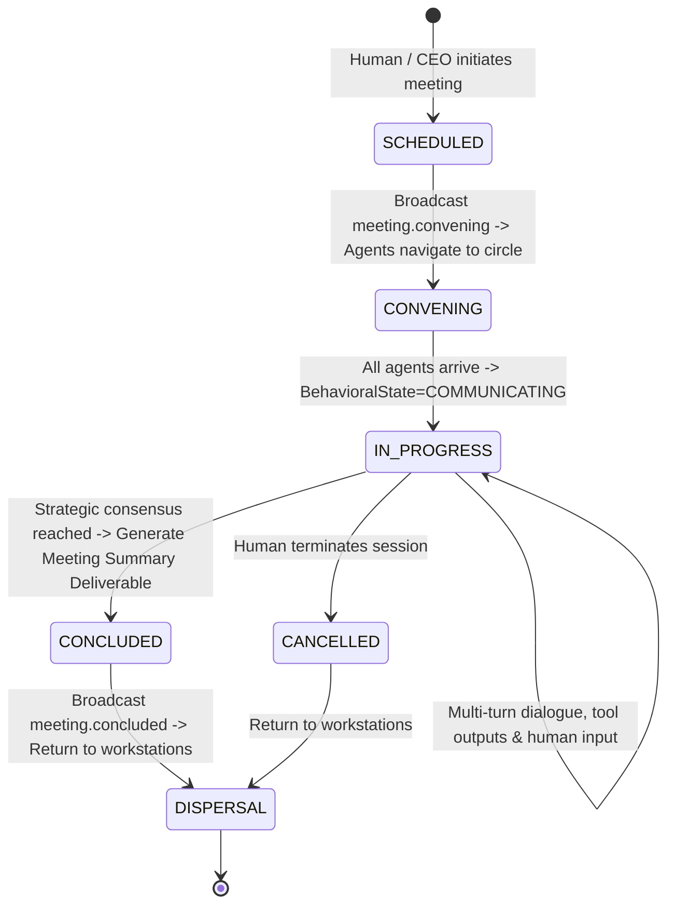

# Phase 4.3: Pre-Implementation Architecture Audit Report
**Project:** PROVIPAGENT — Autonomous AI Company OS  
**Milestone:** Phase 4.3 — Interactive 3D Workspaces & Human-in-the-Loop Collaboration  
**Baseline Certified Checkpoint:** `451477c15db5ba69a56c539e26f9a2c7c60a4cd9`  
**Date:** 2026-11-02  
**Auditor:** Principal AI Systems & 3D Web Architect  
**Audit Scope:** Pre-implementation architecture audit only (no production code modifications, no database schema mutations, no git commit).  

---

## Executive Summary & Final Verdict

**FINAL AUDIT VERDICT:** **PASS — READY FOR PHASE 4.3 IMPLEMENTATION**

The PROVIPAGENT foundation is in an exceptionally healthy state. The Phase 4.2 certified checkpoint (`451477c`) is 100% verified with a clean working tree. All 116 frontend Vitest tests and all 459 backend Pytest tests pass cleanly without errors, and the Next.js production build succeeds with zero TypeScript errors. 

Phase 4.2 successfully established the 3D office physical and spatial layer: 15-node topology graph routing, Dijkstra pathfinding, 2D Spatial Hash Grid collision avoidance ($O(1)$ neighbor queries), corridor lateral evasion, and workstation chair docking. 

Phase 4.3 will elevate this physical simulation into an **interactive Human-in-the-Loop (HITL) control environment**. This audit articulates the architectural gaps, API contracts, WebSocket protocols, security invariants, performance boundaries, and ordered roadmap required to build Phase 4.3 without destabilizing the authoritative backend core.

---

## 1. Baseline Verification

### 1.1 Git Status & Commit Baseline
- **Git HEAD:** `451477c15db5ba69a56c539e26f9a2c7c60a4cd9`
- **Commit Message:** `feat(phase-4.2): implement spatial navigation and multi-agent movement`
- **Working Tree:** Pristine (`nothing to commit, working tree clean`).
- **Branch:** `main`

### 1.2 Automated Test Baselines
- **Frontend Test Suite (Vitest v5.0.5):**
  - Total Files: 12 test files
  - Total Tests: **116 passed / 116 total (100% pass rate)**
  - Execution Time: $307\text{ms}$
- **Backend Test Suite (Pytest v8.3):**
  - Total Tests: **459 passed / 459 total (100% pass rate)**
  - Warnings: 4 non-fatal SQLite connection warnings
  - Execution Time: $92.2\text{s}$
- **Next.js Production Build (`next build`):**
  - Compilation: $408\text{ms}$
  - TypeScript Typecheck: $1343\text{ms}$ (0 errors, 0 warnings)
  - Static Generation: 5/5 static pages generated successfully

---

## 2. Interactive Workstation Audit

### 2.1 Existing Inspection & Workstation Components
Inspection of `Workstation.tsx`, `OfficeCanvas.tsx`, `OfficeScene.tsx`, `DepartmentZone.tsx`, `OfficeInspector.tsx`, and `useOfficeSync.ts` revealed:

1. **Workstation Rendering (`Workstation.tsx`)**:
   - Features PBR wooden tabletop, steel legs, task lamp with point light, ergonomic chair, and dual monitor displays.
   - Screen face uses `meshStandardMaterial` with `emissive` color driven by `occupant_state` (`CANONICAL_STATE_CONFIGS`).
   - Workstation selection is supported via `onClick` propagating `onSelect(data.workstation_id)`.
   - Hover floor halo and simple floating HTML label are rendered, but **no interactive controls or action buttons exist**.

2. **Office Inspector (`OfficeInspector.tsx`)**:
   - Rendered as a slide-out drawer on the right side of the screen when `selection.type !== "none"`.
   - Currently **read-only**: displays agent name, role, behavioral state, active task title, coordinates, and desk occupancy.
   - Features a navigation shortcut (`onFocusAgent`), but lacks task assignment, pause/resume, interruption, approval decision, or live execution terminal capabilities.

3. **Coordinate Consistency**:
   - `DepartmentZone.tsx` passes relative offsets: `ws.pos_x - data.base_x, ws.pos_z - data.base_z`.
   - Workstation chair docking spot is mathematically verified at $(pos\_x, 1.0, pos\_z + 0.65\text{m})$, oriented facing $-Z$ ($\text{yaw} = \pi$).

### 2.2 Phase 4.3 Interactive Workstation Requirements
1. **Contextual 3D Floating Action HUD**:
   - When a workstation is selected, mount a floating 3D radial/action bar directly above the desk:
     - `[⚡ Giao Việc]` (Assign Task to Occupant)
     - `[⏸️ Tạm Dừng / Tiếp Tục]` (Pause / Resume Task)
     - `[🛑 Hủy Nhiệm Vụ]` (Cancel Task)
     - `[💬 Trò Chuyện / Can Thiệp]` (Direct Prompt / Intervene)
     - `[💻 Bật Terminal Bàn]` (Open Interactive Workstation Terminal)
2. **Screen Click Raycasting**:
   - Clicking directly on the 3D dual-monitor geometry should trigger an in-scene camera zoom to first-person desk view and open the workstation live telemetry stream.
3. **Agent-to-Workstation Reassignment**:
   - Enable dragging or selecting an unassigned/vacant desk to reassign an agent from the inspector drawer with backend validation (`POST /api/v1/workstations/{id}/reassign`).

---

## 3. Human-in-the-Loop (HITL) Architecture

### 3.1 Existing Task & Agent Runtime State Machine
Inspection of `backend/app/agent_runtime/lifecycle/task_lifecycle.py`, `backend/app/services/task_service.py`, `backend/app/agent_runtime/dispatcher/dispatcher.py`, and `backend/app/agent_runtime/orchestrator/multi_agent_orchestrator.py` revealed:

1. **Canonical Task States**:
   `CREATED`, `PLANNING`, `READY`, `ASSIGNED`, `QUEUED`, `IN_PROGRESS`, `WAITING`, `REVIEW`, `COMPLETED`, `FAILED`, `CANCELLED`.
2. **State Transition Rules**:
   - `IN_PROGRESS` $\rightarrow$ `WAITING`, `REVIEW`, `COMPLETED`, `FAILED`, `CANCELLED`.
   - `WAITING` $\rightarrow$ `IN_PROGRESS`, `FAILED`, `CANCELLED`.
   - `REVIEW` $\rightarrow$ `COMPLETED`, `FAILED`, `IN_PROGRESS`, `CANCELLED`.
3. **Existing Capabilities**:
   - `task_service.create_task`: Scoped to tenant, logs `task.created`, broadcasts to WebSocket.
   - `task_service.cancel_task`: Calls `agent_runtime.cancel_task()`, sets `status = cancelled`, releases agent, broadcasts `task.cancelled`.
   - `approval_service.decide_approval`: Accepts decision (`approved` / `rejected`). If rejected, marks task failed and releases agent.

### 3.2 Critical Architectural Gaps in HITL
1. **Approval Resume Defect (Gap HITL-01)**:
   In `approval_service.decide_approval()`, when `decision == "approved"`, the approval record is marked `approved`, but **the associated `TaskModel` is not transitioned back to `in_progress` or `ready`**, and the `TaskDispatcher` is not notified to resume execution. The task remains permanently stuck in `waiting_approval`.
2. **Missing Pause / Resume Endpoints (Gap HITL-02)**:
   There are currently no endpoints for pausing an in-flight task (`POST /tasks/{id}/pause`) or resuming it (`POST /tasks/{id}/resume`).
3. **Missing Interruption / Human Override Input (Gap HITL-03)**:
   No mechanism exists for a human operator to inject guidance, clarify instructions, or alter parameters while an agent is thinking or executing a tool loop.
4. **Authoritative State Rule**:
   The frontend must **never** mutate task status optimistically. All human interventions must dispatch to FastAPI REST endpoints, execute inside a database transaction, and emit authoritative WebSocket event envelopes.

---

## 4. Real-Time Communication Architecture

### 4.1 Existing WebSocket Infrastructure (`websocket_manager.py`)
1. **Authentication & Tenant Isolation**:
   - Query parameter `token` or `Sec-WebSocket-Protocol` is decoded via JWT.
   - Organization scope `conn_org` is bound server-side.
   - `broadcast_envelope` enforces strict tenant filtering: clients only receive events matching their `organization_id` (superadmins can observe across orgs).
2. **Downstream Event Ordering & Watermarking**:
   - Monotonic `sequence_id` is assigned to each `AgentEventModel`.
   - `resync` and `replay` control actions allow clients to retrieve missed events after `last_sequence_id`.
   - `useOfficeSync.ts` implements `latestSequenceRef` watermark protection to prevent stale snapshots from rolling back active movement states.

### 4.2 Gaps for Phase 4.3 Real-Time Interactivity
1. **Bidirectional Protocol Boundary**:
   - Client currently sends only `ping`, `resync`, and `replay` via WebSocket.
   - **Architectural Decision**: Keep state-mutating actions (task creation, pauses, approvals, cancellations, reassignments) on **REST endpoints**. REST provides HTTP status codes, granular RBAC middleware, and transactional ACID guarantees. WebSocket will remain the dedicated real-time downstream broadcast channel for event envelopes.
2. **New Event Types Required for HITL**:
   - `task.paused`
   - `task.resumed`
   - `task.interrupted`
   - `task.reassigned`
   - `approval.requested`
   - `approval.resolved`
   - `meeting.convening`
   - `meeting.started`
   - `meeting.message_added`
   - `meeting.concluded`

---

## 5. Multi-Agent Meeting System

### 5.1 Spatial vs. Cognitive Gathering
Phase 4.2 implemented `officeNavEngine.generateMeetingFormation(agentIds, center, radius)`, which computes circular physical positions around the Executive Suite $(0, 1, -12)$ or Atrium $(0, 1, 3)$. 

However, **spatial positioning alone does not constitute multi-agent collaboration**. In Phase 4.3, spatial assembly must be coupled with an authoritative cognitive collaboration session.

### 5.2 Meeting Session Architecture


### 5.3 Meeting Capabilities to Implement
1. **Meeting Entity & Database Model (`MeetingModel`)**:
   - Tracks `id`, `organization_id`, `task_id`, `title`, `agenda`, `status`, `facilitator_id`, `participants`, `started_at`, `concluded_at`.
2. **Participant Roles**:
   - Facilitator (CEO or Human), Contributing Specialists, Scribe/Synthesizer.
3. **Human Participation**:
   - Humans can join the meeting room chat, view real-time agent dialogue, and inject prompts/guidance (`POST /api/v1/meetings/{id}/messages`).
4. **Synthesized Meeting Deliverable**:
   - On conclusion, the engine produces an immutable `MeetingSummaryDeliverable` containing decisions, key findings, and auto-generated child tasks assigned to specialists.

---

## 6. Security & Reliability Audit

| Domain | Current Implementation | Phase 4.3 Hardening Requirement | Risk Level |
| :--- | :--- | :--- | :---: |
| **Tenant Isolation** | All tables store `organization_id`. `NavigationService`, `TaskService`, and `WebSocketManager` enforce org checks. | Ensure new `MeetingModel` and HITL intervention endpoints strictly filter by `tenant_org`. | **Low** |
| **RBAC Permissions** | Basic roles in `auth.py` (`ORGANIZATION_OWNER`, `ADMIN`, `MEMBER`). | Add explicit permissions: `PERM_INTERVENE_TASK`, `PERM_APPROVE_ACTION`, `PERM_INITIATE_MEETING`. | **Medium** |
| **Concurrent Mutations** | SQLite transactions; `SessionLocal` per request. | Prevent race conditions when human pauses while agent completes a step. Use optimistic locking (`version` column or `SELECT FOR UPDATE` semantics). | **Medium** |
| **Idempotency** | Supported on task creation via `idempotency_key`. | Enforce idempotency on `pause`, `resume`, `approve`, and `interrupt` actions. | **Low** |
| **Crash Recovery** | `recover_abandoned_tasks` runs on startup. | Extend crash recovery to restore paused tasks and resolve interrupted meeting sessions cleanly on reboot. | **Medium** |

---

## 7. Proposed API Contracts

### 7.1 Human Task Intervention Endpoints (`backend/app/api/v1/endpoints/tasks.py`)

#### `POST /api/v1/tasks/{task_id}/pause`
- **Headers:** `Authorization: Bearer <token>`, `X-Organization-ID: <org_id>`
- **Request Body:**
  ```json
  {
    "reason": "Human operator paused for strategy review"
  }
  ```
- **Response (200 OK):**
  ```json
  {
    "task_id": "task-uuid",
    "status": "waiting",
    "is_paused": true,
    "paused_at": "2026-11-02T08:15:00Z",
    "message": "Task successfully paused"
  }
  ```

#### `POST /api/v1/tasks/{task_id}/resume`
- **Headers:** `Authorization: Bearer <token>`, `X-Organization-ID: <org_id>`
- **Request Body:**
  ```json
  {
    "guidance": "Proceed with alternative tool strategy"
  }
  ```
- **Response (200 OK):**
  ```json
  {
    "task_id": "task-uuid",
    "status": "in_progress",
    "is_paused": false,
    "resumed_at": "2026-11-02T08:16:00Z",
    "message": "Task successfully resumed"
  }
  ```

#### `POST /api/v1/tasks/{task_id}/interrupt`
- **Request Body:**
  ```json
  {
    "override_instruction": "Stop searching Google; use local documents instead",
    "force_release_agent": false
  }
  ```
- **Response (200 OK):** Intercepts active execution token, injects human prompt into agent context, and restarts current step.

#### `POST /api/v1/tasks/{task_id}/reassign`
- **Request Body:**
  ```json
  {
    "new_agent_id": "agent-research-lead",
    "reason": "Reassigning to domain specialist"
  }
  ```
- **Response (200 OK):** Validates new agent lifecycle & tenant, frees previous agent, rebinds task, and transitions state to `ASSIGNED`.

### 7.2 Meeting Collaboration Endpoints (`backend/app/api/v1/endpoints/meetings.py`)

#### `POST /api/v1/meetings`
- **Request Body:**
  ```json
  {
    "title": "Quarterly AI Alignment Meeting",
    "agenda": "Review enterprise multi-agent deployment strategy",
    "zone_id": "executive_suite",
    "participant_agent_ids": ["agent-exec-ceo", "agent-eng-lead", "agent-research-lead"],
    "parent_task_id": null
  }
  ```
- **Response (201 Created):**
  ```json
  {
    "meeting_id": "meet-uuid",
    "status": "convening",
    "meeting_coordinates": [0.0, 1.0, -12.0],
    "participants": [ ... ],
    "created_at": "2026-11-02T08:20:00Z"
  }
  ```

#### `POST /api/v1/meetings/{meeting_id}/messages`
- **Request Body:**
  ```json
  {
    "sender_type": "human",
    "message_text": "CEO, what is our top priority for the engineering bay today?"
  }
  ```
- **Response (201 Created):** Dispatches human message into meeting context; CEO responds autonomously.

#### `POST /api/v1/meetings/{meeting_id}/conclude`
- **Response (200 OK):** Synthesizes meeting deliverable, stores action items, and broadcasts dispersal signal.

---

## 8. WebSocket Event Contracts

All real-time envelopes adhere strictly to the standardized envelope schema:
```json
{
  "schema_version": 1,
  "event_id": "evt-uuid",
  "event_type": "<namespace>.<action>",
  "agent_id": "<agent_id_or_null>",
  "task_id": "<task_id_or_null>",
  "organization_id": "<org_id>",
  "occurred_at": "2026-11-02T08:25:00.000000Z",
  "sequence_id": 482,
  "payload": { ... }
}
```

### Event Taxonomy for Phase 4.3
1. `task.paused`: Emitted when an operator pauses a running task.
2. `task.resumed`: Emitted when a task is resumed with optional human guidance.
3. `task.interrupted`: Emitted when a human operator overrides an agent's active execution.
4. `task.reassigned`: Emitted when task ownership is transferred between agents.
5. `approval.requested`: Emitted when an agent hits a high-risk tool policy requiring human sign-off.
6. `approval.resolved`: Emitted when human grants or denies permission.
7. `meeting.convening`: Emitted when agents are ordered to gather at the meeting hub.
8. `meeting.started`: Emitted when all participants arrive and discussion commences.
9. `meeting.message_added`: Emitted for every dialogue turn (agent or human).
10. `meeting.concluded`: Emitted when the meeting ends, signaling workstation dispersal.

---

## 9. Database Migration Requirements

### 9.1 New Tables Required
```python
# 1. meetings table
class MeetingModel(Base):
    __tablename__ = "meetings"
    id = Column(String(64), primary_key=True)
    organization_id = Column(String(64), ForeignKey("organizations.id"), nullable=False, index=True)
    task_id = Column(String(64), ForeignKey("tasks.id"), nullable=True)
    title = Column(String(255), nullable=False)
    agenda = Column(Text, nullable=True)
    status = Column(String(32), default="convening", nullable=False)  # convening, in_progress, concluded, cancelled
    zone_id = Column(String(64), default="executive_suite", nullable=False)
    facilitator_id = Column(String(64), nullable=True)
    created_by = Column(String(64), nullable=True)
    summary_deliverable_json = Column(JSON, nullable=True)
    started_at = Column(DateTime, nullable=True)
    concluded_at = Column(DateTime, nullable=True)
    created_at = Column(DateTime, default=datetime.utcnow, nullable=False)
    updated_at = Column(DateTime, default=datetime.utcnow, onupdate=datetime.utcnow)

# 2. meeting_participants table
class MeetingParticipantModel(Base):
    __tablename__ = "meeting_participants"
    id = Column(String(64), primary_key=True)
    meeting_id = Column(String(64), ForeignKey("meetings.id"), nullable=False, index=True)
    agent_id = Column(String(64), ForeignKey("agents.id"), nullable=False)
    role = Column(String(64), default="participant")
    status = Column(String(32), default="invited")  # invited, transit, seated, left

# 3. meeting_messages table
class MeetingMessageModel(Base):
    __tablename__ = "meeting_messages"
    id = Column(String(64), primary_key=True)
    meeting_id = Column(String(64), ForeignKey("meetings.id"), nullable=False, index=True)
    sender_type = Column(String(32), nullable=False)  # agent, human, system
    sender_id = Column(String(64), nullable=False)
    sender_name = Column(String(128), nullable=False)
    message_text = Column(Text, nullable=False)
    created_at = Column(DateTime, default=datetime.utcnow, nullable=False)
```

### 9.2 Alterations to Existing Tables
- `tasks` table: Add `paused_at` (DateTime, nullable), `pause_reason` (String, nullable), `is_paused` (Boolean, default False).

---

## 10. Performance Risks & Mitigation

1. **3D Scene DOM Thrashing from HTML Overlays**:
   - *Risk:* Rendering complex `<Html>` components for 24 workstations simultaneously degrades Three.js FPS.
   - *Mitigation:* Render the interactive 3D Floating Action HUD **only** for the currently selected workstation (`selectedWorkstationId === ws.workstation_id`). All unselected workstations render zero 3D DOM overlays.
2. **Raycasting Overhead on High-Poly Workstations**:
   - *Risk:* Per-frame raycasting against multi-part monitor meshes causes micro-stutters.
   - *Mitigation:* Attach pointer event handlers (`onClick`, `onPointerOver`) to a single invisible bounding box mesh (`<mesh visible={false}><boxGeometry args={[2.4, 1.2, 1.2]} /></mesh>`).
3. **Meeting LLM Latency & Cost Explosion**:
   - *Risk:* Multi-agent meetings could consume thousands of LLM tokens or trigger API rate limits.
   - *Mitigation:* Enforce strict turn limits (e.g., maximum 3 turns per specialist per meeting), synthesize via zero-cost models (`openrouter` free fallback chain), and support local deterministic rule orchestration for routine briefings.

---

## 11. Testing Strategy

1. **Backend Integration Tests (`backend/app/tests/`)**:
   - `test_phase4_3_human_intervention.py`: Tests task pause, resume, cancel, and reassignment lifecycle transitions.
   - `test_phase4_3_approval_resolution.py`: Tests approval decision dispatch, verifying that `approved` correctly resumes task execution without hangs.
   - `test_phase4_3_meeting_service.py`: Tests meeting creation, participant invitations, real-time message exchange, and deliverable synthesis.
2. **Frontend Component & Integration Tests (`frontend/tests/`)**:
   - `phase4_3_interactive_workstation.test.ts`: Tests workstation selection, action HUD triggering, and monitor click raycasting.
   - `phase4_3_human_intervention_ui.test.ts`: Tests pause/resume buttons, approval modal responses, and terminal live streaming.
   - `phase4_3_meeting_system.test.ts`: Tests meeting assembly, circular agent positioning, real-time message ingestion, and dispersal navigation.

---

## 12. Ordered Implementation Roadmap

```
Subphase 4.3.1 ──> Subphase 4.3.2 ──> Subphase 4.3.3 ──> Subphase 4.3.4 ──> Subphase 4.3.5 ──> Subphase 4.3.6 ──> Subphase 4.3.7
(Workstation HUD)   (HITL Pause/Resume) (Approval Dispatch) (Meeting Backend)  (Meeting UI & 3D)  (Live Desk Terminal) (Hardening & Cert)
```

1. **Subphase 4.3.1 — Interactive Workstation Selection & 3D Action HUD**:
   - Build `WorkstationActionHUD.tsx` mounted above selected workstation.
   - Wire quick-action buttons: Assign Task, Pause/Resume, Inspect, Open Terminal.
2. **Subphase 4.3.2 — Human-in-the-Loop Task Interruption, Pause & Resume API**:
   - Implement `POST /api/v1/tasks/{id}/pause` and `POST /api/v1/tasks/{id}/resume`.
   - Update `TaskLifecycleEngine` and `TaskDispatcher` to pause and resume worker loops cleanly.
3. **Subphase 4.3.3 — Approval Checkpoint Resolution & Dispatcher Auto-Resume**:
   - Fix Gap HITL-01: When human approves via `POST /api/v1/approvals/{id}/decision`, auto-resume task and re-enqueue to dispatcher.
4. **Subphase 4.3.4 — Multi-Agent Meeting Backend & Lifecycle Engine**:
   - Implement `MeetingModel`, `MeetingParticipantModel`, `MeetingMessageModel`.
   - Mount `/api/v1/meetings` endpoints (create, start, message, conclude).
5. **Subphase 4.3.5 — 3D Meeting Collaboration & Dispersal Integration**:
   - Connect meeting start/conclude events to `officeNavEngine` meeting formation and dispersal routing.
   - Display meeting conference table halo and live dialogue speech bubbles above seated agents.
6. **Subphase 4.3.6 — Interactive Workstation Screen Terminal & Live Log Streaming**:
   - Implement camera transition to desk monitor.
   - Display real-time streaming tool logs, thinking traces, and deliverable previews on the workstation screen.
7. **Subphase 4.3.7 — Security Hardening, Multi-Tenant Audits & End-to-End Certification**:
   - Execute full test suite, verify multi-tenant isolation, verify zero regressions on Phase 4.2 features, and certify Phase 4.3.

---

## 13. Acceptance Criteria for Every Subphase

| Subphase | Acceptance Criteria |
| :--- | :--- |
| **4.3.1** | Clicking any physical workstation opens the 3D Action HUD. HUD renders only on selected desk; 0 draw-call leaks. |
| **4.3.2** | Human can pause an in-flight task; task transitions to `waiting`; agent state reflects `WAITING`. Resuming returns task to `in_progress` without duplicating steps. |
| **4.3.3** | Resolving a pending approval with `decision=approved` immediately resumes execution without manual server restart. |
| **4.3.4** | Calling `POST /api/v1/meetings` persists meeting record; agents receive spatial transit commands to meeting circle. |
| **4.3.5** | Participating agents assemble in circular formation ($R = 2.5\text{m}$, separation $\ge 1.2\text{m}$); speech turns stream via WebSocket; concluding meeting triggers dispersal back to assigned desks. |
| **4.3.6** | Clicking desk monitor opens live terminal viewer; tool executions, stdout, and deliverables stream with zero UI lag. |
| **4.3.7** | 100% of frontend tests pass; 100% of backend tests pass; Next.js builds cleanly; zero cross-tenant event leaks. |

---

## 14. Pre-Implementation Audit Conclusion

The codebase is thoroughly prepared for Phase 4.3. All architectural prerequisites and existing assets have been inspected, documented, and verified. 

**FINAL VERDICT:** **PASS — READY FOR PHASE 4.3 IMPLEMENTATION**.

